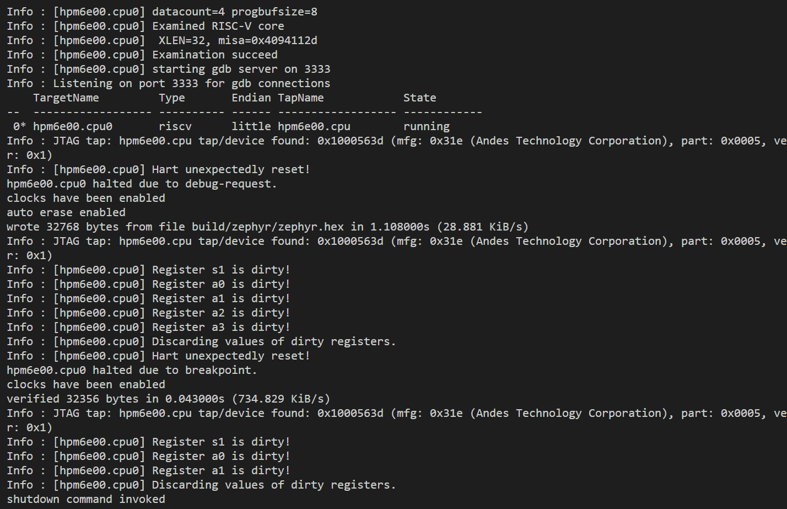

# 故障排查

排查时先找“最后一个正常结果”，再检查紧邻的下一层。这样可以避免同时怀疑环境、Board、JTAG、Flash 和应用。

## 工作区与工具

### 一、二期完整工程包

在解压后的工程根目录打开 PowerShell，先确认工作区和内置工具齐全：

```powershell
Test-Path .\.west\config
Test-Path .\sdk\python\python.exe
Test-Path .\sdk\git\cmd\git.exe
Test-Path .\sdk\cmake\bin\cmake.exe
.\.venv\Scripts\python.exe -m west --version
```

前四项应为 `True`，最后一项应显示 west 1.5.0。缺少文件时应重新取得完整工程包。`.venv\Scripts` 里只有两个原生启动器，它们按自身位置使用工程内的 Python、Git、CMake、Ninja 与工具链，**不需要激活，也不是普通虚拟环境**。因此当前 PowerShell 中的 `Get-Command python` 或 `Get-Command git` 指向系统安装位置，并不能说明工程入口选错了工具。

要检查实际构建路径，从工程根目录执行：

```powershell
.\.venv\Scripts\python.exe -m west build -b dshanmcu_hpm6e70 applications\hpm6e70_demo -d build\hpm6e70_demo
Select-String .\build\hpm6e70_demo\CMakeCache.txt -Pattern '^(WEST_PYTHON|DTC|CMAKE_MAKE_PROGRAM|CMAKE_HOME_DIRECTORY):'
```

构建结束后，`WEST_PYTHON`、`DTC` 和 `CMAKE_MAKE_PROGRAM` 应指向当前工程目录下的 `sdk/`；`CMAKE_HOME_DIRECTORY` 应指向当前工程的 `applications/hpm6e70_demo/`。不要把另一台电脑复制来的 `build/` 当作可移植缓存；首次在新路径构建时，west 会检测旧路径并重新配置。

### 三期从零搭建的手动 west 环境

只有按三期课程从空目录建立工作区时，才激活当时创建的虚拟环境：

```powershell
Set-ExecutionPolicy -Scope Process Bypass -Force
.\.venv\Scripts\Activate.ps1
$env:PYTHONUTF8 = '1'
west --version
west list zephyr sdk_env sdk_glue
```

如果此路线的 `west` 无法识别，再检查 `.\.venv\Scripts\west.exe` 是否存在并重新激活；不要把这个步骤套用到一、二期完整工程包。

### CMake 报工具链无法编译 dummy C 文件

如果配置阶段在 `zephyr/cmake/modules/kernel.cmake:145` 停止，并出现：

```text
The toolchain is unable to build a dummy C file
```

这一步是编译器自检，还没有进入 Board、设备树或应用代码。常见原因是把另一台电脑的 `build/` 或 `zephyr/.cache/ToolchainCapabilityDatabase/` 一起复制过来，缓存中的工具链判断已经失效。

在一、二期完整工程根目录执行：

```powershell
Remove-Item .\build -Recurse -Force -ErrorAction SilentlyContinue
Remove-Item .\zephyr\.cache -Recurse -Force -ErrorAction SilentlyContinue
.\.venv\Scripts\python.exe -m west build -p always -b dshanmcu_hpm6e70 applications\hpm6e70_demo -d build\hpm6e70_demo
```

交付工程以完整目录携带（含 `.west/`、`sdk/`、`.venv/`），不包含另一台电脑的 `build/` 与 `zephyr/.cache`；构建时会在当前电脑重新建立工具链能力缓存。如果清理后仍失败，再打开 `build/hpm6e70_demo/CMakeFiles/CMakeError.log`，查看编译器实际报错，而不要只根据最后的 CMake 调用栈判断。

若构建在读取 `board.yml`、DTS 或其他 UTF-8 文件时出现下面这类错误：

```text
UnicodeDecodeError: 'gbk' codec can't decode byte ...
```

说明直接执行的 Python 使用了中文 Windows 的系统默认编码。三期手动调用 west 时，在当前终端设置：

```powershell
$env:PYTHONUTF8 = '1'
```

随后重新执行原来的 west 命令。该变量不会永久修改系统设置；每次打开新的 Windows PowerShell 后都需要重新设置。一、二期的 `.venv\Scripts` 启动器已为子进程设置 `PYTHONUTF8=1`，通常不需要手动设置。

若三期手动执行 `west build` 时，CMake 报错位置包含 `FindZephyr-sdk.cmake`，先检查当前命令来自哪里：

```powershell
Get-Command cmake | Select-Object Source
cmake --version
```

路径应指向当前工程的 `sdk\cmake\bin\cmake.exe`，本工作区自带版本为 3.24.0。若手动命令找到的是系统目录或 `.venv`，把集中到 `sdk/` 的 CMake 与 Ninja 放到 PATH 最前面：

```powershell
$env:Path = "$PWD\sdk\cmake\bin;$PWD\sdk\ninja;$env:Path"
Get-Command cmake, ninja | Select-Object Name, Source
```

三期手动构建若提示找不到 Zephyr SDK 或工具链，设置当前终端使用 `sdk/` 中的工具链与 `sdk_env` 中的 HPM SDK：

```powershell
$env:ZEPHYR_TOOLCHAIN_VARIANT = 'cross-compile'
$env:CROSS_COMPILE = "$PWD\sdk\riscv-toolchain\bin\riscv32-unknown-elf-"
$env:HPM_SDK_DIR = "$PWD\sdk_env\hpm_sdk"
Test-Path "${env:CROSS_COMPILE}gcc.exe"
```

最后一条必须输出 `True`。一、二期启动器会自行设置工具链环境变量；若一、二期构建报工具链文件缺失，先核对交付包内的 `sdk/riscv-toolchain/` 是否完整。

## 找不到 Board

一、二期先用 `.\.venv\Scripts\python.exe -m west build -b dshanmcu_hpm6e70 applications\hpm6e70_demo -d build\hpm6e70_demo` 重现问题；三期手动 west 路线可执行：

```powershell
west boards --board-root .\platform --board dshanmcu_hpm6e70
```

没有输出时依次检查：

1. `platform/boards/hpmicro/dshanmcu_hpm6e70/board.yml` 是否存在；
2. `board.name` 是否为 `dshanmcu_hpm6e70`；
3. `platform/zephyr/module.yml` 是否存在且 `board_root: .` 设置完好——板卡搜索根目录由它自动登记，应用 `CMakeLists.txt` 不需要也不应该再写 `BOARD_ROOT`。

## DTS 或 Kconfig 修改没有生效

一、二期修改板级配置后，在完整工程根目录全量重建指定应用：

```powershell
.\.venv\Scripts\python.exe -m west build -p always -b dshanmcu_hpm6e70 applications\hpm6e70_demo -d build\hpm6e70_demo
Select-String .\build\hpm6e70_demo\zephyr\zephyr.dts -Pattern 'uart0|flash@0'
Select-String .\build\hpm6e70_demo\zephyr\.config -Pattern 'CONFIG_SOC_HPM6E70=y|CONFIG_XIP=y|CONFIG_UART_CONSOLE=y'
```

三期从零搭建、手动调用 west 时，按该路线使用的应用目录和构建目录执行全新配置：

```powershell
west build -p always -b dshanmcu_hpm6e70/hpm6e70 .\applications\blinky -d .\build\blinky
```

然后检查最终合并结果，而不是只看源文件：

```powershell
Select-String .\build\blinky\zephyr\zephyr.dts -Pattern 'uart0|green LED|flash@0'
Select-String .\build\blinky\zephyr\.config -Pattern 'CONFIG_SOC_HPM6E70=y|CONFIG_XIP=y|CONFIG_UART_CONSOLE=y'
```

## 警告与失败怎样区分

出现 `warning` 后仍生成 `zephyr.elf`，表示构建完成但存在待处理问题；出现 `FATAL ERROR`、`CMake Error` 或 Ninja 停止，才是本次构建失败。不要只根据终端颜色判断结果。

## JTAG 与烧录



- `CH347 not found`：电脑没有发现调试器，检查 USB、WinUSB 接口和占用进程；
- TAP ID 全为 0 或 1：检查 TCK、TMS、TDI、TDO、GND 和目标板供电；
- 请求 500 kHz 实际显示 938 kHz：CH347F 选择了可用的相邻频率，不代表连接失败；
- `wrote ... bytes` 与 `verified ... bytes` 先后出现，才表示写入完成且已读回校验。

接线、WinUSB 接口选择和 `runners.yaml` 的逐层检查见[连接并验证 JTAG](../common-04-连接JTAG与OpenOCD/README.md)。

## 串口偶尔出现残缺字符

少量、偶发的乱码通常来自复位瞬间、连接器接触或串口接收从一帧中间开始。若随后持续输出正常，可先记录现象；若频繁发生，再检查 115200 8N1、地线、TX/RX 连接和供电稳定性。

UART0 接线、COM 端口确认和 VS Code Serial Monitor 设置见[连接串口并确认 COM 端口](../common-05-连接串口并查看日志/README.md)。

## SDRAM 初始化状态一直是 -1

现象：SDRAM 测试应用在第一步打印 `FAIL [pre-kernel init] status=-1`。

`-1` 是 `board_sdram.c` 中 `sdram_init_status` 的初始值，只有一种情况会出现：`_init_ext_ram()` 从来没有被调用。HPM 裸机 SDK 由各 SoC 的 `start.S` 执行 `call _init_ext_ram`，而 Zephyr 的启动路径不经过它，`zsg` fork 也没有实现这个调用。检查 `board_sdram.c` 末尾是否有把初始化挂进内核启动序列的 `SYS_INIT(board_sdram_sys_init, PRE_KERNEL_2, 0)`；补上并重新构建烧录后，状态应变为 `0`，测试继续执行数据线、字节通道和地址线各阶段。

接入方法见[把板载 SDRAM 接入 Board](../p3-10-适配板载SDRAM/README.md)。

## 编辑器误报与命令行构建的区别

VS Code 的红色波浪线来自编辑器索引，`west build` 才使用最终设备树和生成头文件。命令行编译成功但编辑器误报时，应更新 `compile_commands.json` 或 C/C++ 配置，不要为消除误报修改正确代码。
