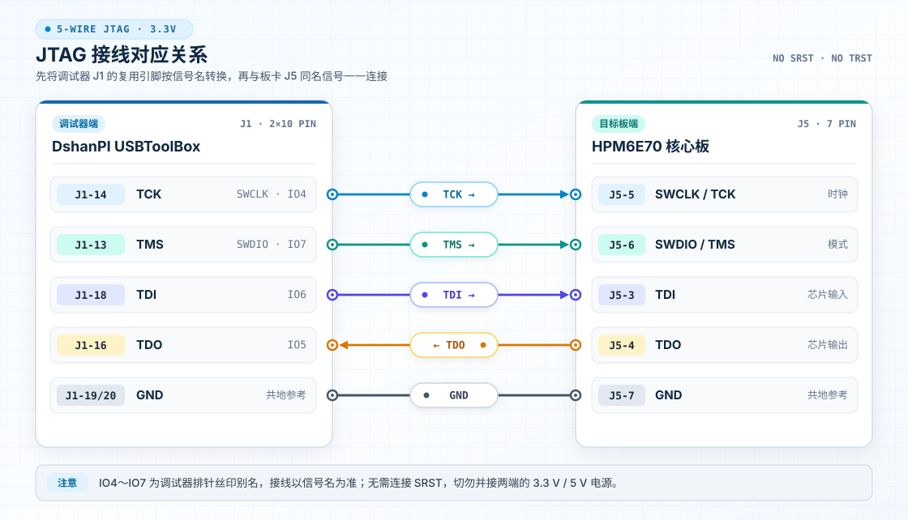
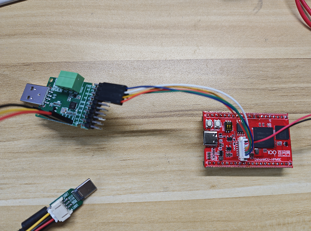
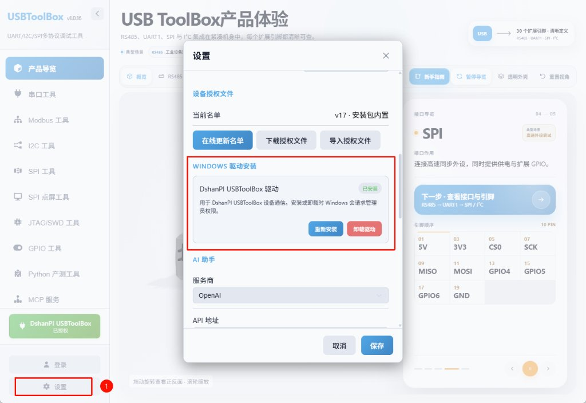
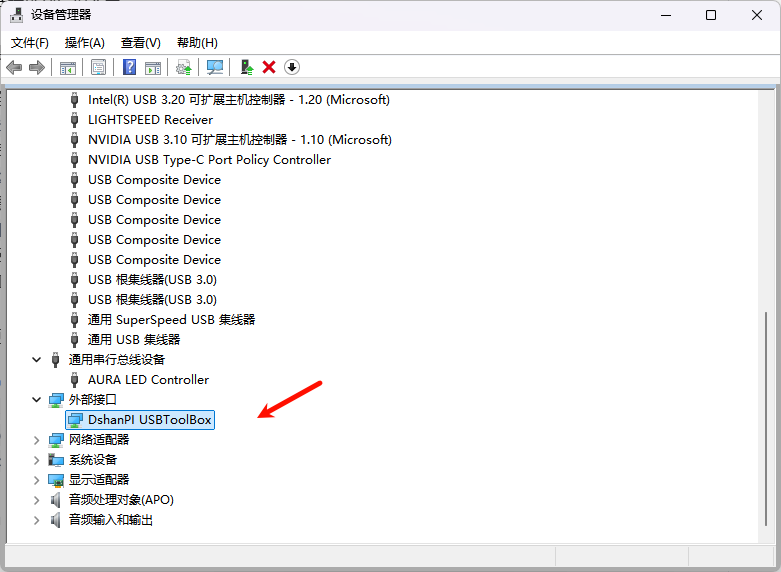

# 连接并验证 JTAG

本课把 `DshanPI USBToolBox` 调试器的 **JTAG 烧录调试接口** 连接到板卡，并安装 Windows 驱动。第一期快速体验通过 [`DshanPI USBToolBox`](https://dl.100ask.net/Tools/usbtoolsbox/) 图形化工具直接烧录 `.hex` 固件；第二、三期源码开发则通过这条接口使用 `west flash` 烧录和在线调试。这里先把硬件连接和驱动准备就绪。

:::info[完成后的可见结果]
设备管理器的 **外部接口** 下出现 `DshanPI USBToolBox`（对应 JTAG 烧录调试接口），**端口（COM 和 LPT）** 下出现 `DshanPI USBToolBox UART1` 与 `DshanPI USBToolBox RS-485 Port`。
:::

## JTAG 五根线分别传递什么

| 信号 | 方向 | 作用 |
| --- | --- | --- |
| TCK | 调试器 → HPM6E70 | 为 JTAG 状态机提供时钟 |
| TMS | 调试器 → HPM6E70 | 控制 JTAG 状态机切换 |
| TDI | 调试器 → HPM6E70 | 数据进入目标芯片 |
| TDO | HPM6E70 → 调试器 | 数据从目标芯片返回 |
| GND | 双方共用 | 建立相同的电压参考 |

`TDI` 和 `TDO` 的 I/O 以目标芯片为参照。调试器丝印中的 `IO4～IO7` 是复用名称，不能按照数字顺序猜测它们对应哪根 JTAG 线。

## 核对调试器 J1 与板卡 J5 的针脚

配套使用的 `DshanPI USBToolBox` 调试器在 J1 排针上同时标有 GPIO 与 JTAG 复用名称。先按下表找到 J1 的针脚编号，再核对手中调试器的实物标识；若调试器版本、接口方向或针脚标识不同，请以实物丝印为准。

| 调试器 J1 针脚 | 丝印或复用名称 | JTAG 信号 |
| --- | --- | --- |
| J1-14 | TCK / SWCLK / IO4 | TCK |
| J1-13 | TMS / SWDIO / IO7 | TMS |
| J1-18 | TDI / IO6 | TDI |
| J1-16 | TDO / IO5 | TDO |
| J1-19 或 J1-20 | GND | GND |

HPM6E70 板卡的 J5 调试接口针脚与信号如下（可对照课程配套原理图 `DshanMCU-HPM6E8Y_SCH_V1.pdf` 核对）：

| HPM6E70 J5 针脚 | 信号 |
| --- | --- |
| J5-3 | TDI |
| J5-4 | TDO |
| J5-5 | SWCLK / TCK |
| J5-6 | SWDIO / TMS |
| J5-7 | GND |

两端都转换成 JTAG 信号名后，再连接同名信号：



## 断电完成接线

:::caution[接线前先断电]
先拔掉目标板和调试器的 USB，再连接排针。不要在两块板上电时移动杜邦线，也不要把两端的 3.3 V 或 5 V 电源并在一起。
:::

按下面的顺序连接：

| 调试器 J1 | HPM6E70 J5 | 作用 |
| --- | --- | --- |
| J1-14 / TCK / IO4 | J5-5 / SWCLK / TCK | 调试时钟 |
| J1-13 / TMS / IO7 | J5-6 / SWDIO / TMS | 模式选择 |
| J1-18 / TDI / IO6 | J5-3 / TDI | 数据进入目标芯片 |
| J1-16 / TDO / IO5 | J5-4 / TDO | 数据从目标芯片返回 |
| J1-19 或 J1-20 / GND | J5-7 / GND | 共地 |

接好后先观察实物照片中的两个位置：左侧调试器使用 J1 排针，右侧 HPM6E70 板使用 J5 调试排针；五根线只连接 TCK、TMS、TDI、TDO 和 GND。



<p className="image-caption">JTAG 实物连接：调试器 J1 与板卡 J5 之间使用五根信号线；照片下方的 USB-C 分离器不参与 JTAG 通信。</p>

线材颜色只用于在照片中区分导线，不能替代上面的针脚编号。重新接线时仍应逐根核对 J1、J5 和信号名称。

本工程的 OpenOCD 配置使用五线 JTAG，并通过 RISC-V 调试模块复位目标，因此不需要连接 `SRST`、`TRST`。两块板各自通过 USB 供电时，也不要用杜邦线并接 3.3 V 或 5 V 电源。

完成接线后先给 HPM6E70 板卡上电，再将调试器接入电脑 USB。若 USB 反复断开、线缆或器件异常发热，应立即断电重新核对排针方向。

## 安装 DshanPI USBToolBox 驱动

`DshanPI USBToolBox` 调试器会在 Windows 上同时枚举出串口通道与 JTAG 烧录调试接口，使用前需安装配套驱动。以下两种方式任选其一安装一次即可。

### 方式一：运行工程内驱动脚本

在工程根目录以管理员权限运行（或在资源管理器中右键 **以管理员身份运行**）：

```powershell
.\sdk\driver\Install-DshanPI-USBToolBox.cmd
```

### 方式二：使用 USBToolBox 上位机软件

可从 [DshanPI USBToolBox 下载目录](https://dl.100ask.net/Tools/usbtoolsbox/) 获取并安装 `DshanPI USBToolBox` 上位机（首次启动会弹出安装向导），也可手动点击左下角 **① 设置**，在弹窗中找到 **WINDOWS 驱动安装 → DshanPI USBToolBox 驱动** 完成安装；已安装时会显示 **已安装**，需要修复驱动时可点击 **重新安装**（安装或卸载时 Windows 会请求管理员权限）：



## 在设备管理器验证 JTAG 烧录调试接口

安装完成后重新插拔调试器，打开 Windows 设备管理器，展开 **外部接口**（部分驱动环境下会完成重命名），确认可以看到 **`DshanPI USBToolBox`**，且设备图标旁没有黄色感叹号：



同时展开 **端口（COM 和 LPT）**，应当还能看到两个串口通道（其中 `DshanPI USBToolBox UART1` 用于下一篇的日志观察）。

也可以在 PowerShell 中列出同一设备的接口状态：

```powershell
Get-PnpDevice -PresentOnly |
  Where-Object InstanceId -match 'VID_1A86&PID_55DE' |
  Format-Table Class, FriendlyName, Status, InstanceId -AutoSize
```

正常情况下可以看到以下四行（其中的 `COM8`、`COM9` 端口号会随电脑与 USB 口变化）：

```text
Class FriendlyName                          Status InstanceId
----- ------------                          ------ ----------
USB   USB Composite Device                  OK     USB\VID_1A86&PID_55DE\BC82F3ABCD
WCH   DshanPI USBToolBox                    OK     USB\VID_1A86&PID_55DE&MI_04\6&10B0D0A7&0&0004
Ports DshanPI USBToolBox RS-485 Port (COM8) OK     USB\VID_1A86&PID_55DE&MI_00\6&10B0D0A7&0&0000
Ports DshanPI USBToolBox UART1 (COM9)       OK     USB\VID_1A86&PID_55DE&MI_02\6&10B0D0A7&0&0002
```

逐行核对 `Class`、`FriendlyName` 和 `InstanceId`，可以区分同一个调试器中的不同通道：

| 输出特征 | 当前功能 | 正常状态 |
| --- | --- | --- |
| `Class: WCH`、`MI_04`、`DshanPI USBToolBox` | **JTAG 烧录调试接口** | `OK`；供 OpenOCD 与 USBToolBox 烧录使用 |
| `Class: Ports`、`MI_02`、`DshanPI USBToolBox UART1` | 烧录器串口 1，本教程用于接收 UART0 日志 | `OK`；对应 Windows COM 端口 |
| `Class: Ports`、`MI_00`、`DshanPI USBToolBox RS-485 Port` | 烧录器的另一路串口 / RS-485 通道 | `OK` |
| `Class: USB`、`USB Composite Device` | 调试器复合设备父项 | `OK` |

如果 `MI_04` 或串口缺失、带黄色感叹号，可以先在设备管理器中卸载对应异常设备节点，再重新运行一遍 `.\sdk\driver\Install-DshanPI-USBToolBox.cmd`（或在 `DshanPI USBToolBox` 设置中点击 **重新安装**）并重新插拔调试器。

## 完成检查

- [ ] 能把调试器 J1 的 IO4～IO7 转换成 TCK、TDO、TDI、TMS。
- [ ] 五根 JTAG 线与板卡 J5 同名信号对应，且没有并接两块板的电源。
- [ ] 已安装 DshanPI USBToolBox 驱动，设备管理器“外部接口”下可见 `DshanPI USBToolBox`。
- [ ] PowerShell 检查中，`MI_04`（JTAG 烧录调试接口）与两个串口通道状态均为 `OK`。

[上一篇：认识 HPM6E70 板卡](../common-03-认识HPM6E70板卡/README.md) · [下一篇：连接串口并确认 COM 端口](../common-05-连接串口并查看日志/README.md) · [课程目录](../README.md)
