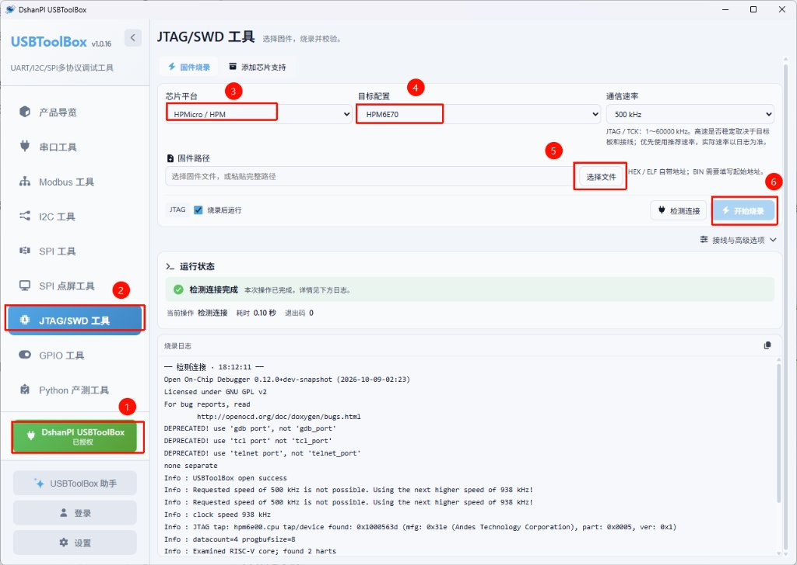

import KitExplorer from '@site/src/components/KitExplorer';

# 第 3 课：有源/无源蜂鸣器

本课下载预编译固件 [`02_buzzer_demo.hex`](https://dl.100ask.net/Hardware/MCU/HPM6E70-ZEPHYR/firmware/02_buzzer_demo.hex) 并通过 [`DshanPI USBToolBox`](https://dl.100ask.net/Tools/usbtoolsbox/) 烧录，快速体验底板 **M9** 插座上的蜂鸣器循环播放 2000 Hz、2500 Hz、3000 Hz 三段测试音并分辨有源/无源模块。

## 硬件准备与接线

<KitExplorer focus="m9" />

将配套的三针蜂鸣器模块插入模块化底板的 **M9** 插座（3.3V）：

| 模块引脚 | 底板 M9 网络 | HPM6E70 引脚 | 复用功能 |
| --- | --- | --- | --- |
| VCC | `3.3V` | — | 3.3V 供电 |
| GND | `GND` | — | 公共地 |
| OUT | `PA8`（底板网络名） | **PF26** | `PWM3_P_2`（PWM3 通道 2） |

:::danger[重要互斥：运行前必须拔掉 M4 红外发射管]
底板 **M9（蜂鸣器）** 与 **M4（红外发射管）** 共用同一根 `PA8` / `PF26` 信号线。运行本示例前，**务必先拔掉 M4 插座上的红外发射模块**；三针模块注意核对 `VCC / GND / OUT` 方向，不要插反。此外，不要直接插只有两只引脚、没有驱动三极管的裸蜂鸣器。
:::

## 下载并烧录体验固件

1. **下载预编译固件**：点击下载 [`02_buzzer_demo.hex`](https://dl.100ask.net/Hardware/MCU/HPM6E70-ZEPHYR/firmware/02_buzzer_demo.hex)（若点击后浏览器直接预览文本，右键链接选择 **“链接另存为”** 保存为 `.hex` 文件）；
2. **使用 [`DshanPI USBToolBox`](https://dl.100ask.net/Tools/usbtoolsbox/) 烧录**：打开上位机，按图中的 `①`～`⑥` 步骤直接烧录：



1. **① 确认设备授权连接**：确保 HPM6E70 板卡已上电、调试器已通过 USB 接入电脑，软件左下角显示绿色 **`DshanPI USBToolBox 已授权`**；
2. **② 打开 JTAG/SWD 工具**：在左侧功能栏点击 **`JTAG/SWD 工具`**，顶部保持在 **`固件烧录`** 页签；
3. **③ 选择芯片平台**：下拉选择 **`HPMicro / HPM`**；
4. **④ 选择目标配置**：下拉选择 **`HPM6E70`**（保持默认通信速率 `500 kHz`，勾选 **`烧录后运行`**）；
5. **⑤ 加载固件**：点击 **`选择文件`**，导入刚下载的 `02_buzzer_demo.hex`（`.hex` 自带烧录地址，无需填写起始地址）；
6. **⑥ 检测并烧录**：可先点 **`检测连接`**（日志出现 `Examined RISC-V core`），再点击 **`开始烧录`**；校验完成后固件会自动复位运行。

> 只需快速体验本外设功能时，以上步骤即已完成烧录；如果需要查阅源码位置、调整设备树配置并使用 `west build` / `west flash` 开发，请见 **[二期第 14 课：有源/无源蜂鸣器开发](../p2-14-有源无源蜂鸣器开发/README.md)**。

## 预期现象与串口日志

烧录后打开串口终端（`115200 8-N-1`，对应本机的 `DshanPI USBToolBox UART1` COM 口）：

1. **声音现象**：模块会循环发出“低 → 中 → 高”三声短音（2000 Hz / 2500 Hz / 3000 Hz）并停顿 2 秒；
   - **无源蜂鸣器**：能明显听出音调由低变高；
   - **有源蜂鸣器**：内部自带振荡器，会以固定音色断续发声（两种情况均属正常，不会损坏模块）；
2. **心跳灯**：核心板绿色 LED（`PC22`）随每声提示与停顿周期翻转；
3. **串口日志示例**：

```text
buzzer demo: devicetree plus driver plus application
SDRAM quick check PASSED (32 MiB)
M9 buzzer driver ready: PF26 / PWM3 channel 2
If pitch changes, the module is passive; fixed pitch means active.

M9 pattern #1: three PWM tones
[BUZZER] LOW    tone 2000 Hz for 150 ms
[BUZZER] MIDDLE tone 2500 Hz for 150 ms
[BUZZER] HIGH   tone 3000 Hz for 400 ms
[BUZZER] pattern complete; silent for 2 seconds
```

## 常见问题排查

| 现象 | 排查方向 |
| --- | --- |
| 串口日志正常，但完全没有声音 | 1. 确认 **M4 红外发射模块已拔掉**；<br/>2. 核对 **M9** 模块方向（`VCC/GND/OUT` 切勿反插）；<br/>3. 确认使用的是带驱动电路的三针蜂鸣器模块，而非裸两脚蜂鸣器；<br/>4. 若自购模块为低电平触发，需调整 PWM 极性，可查看 [二期第 14 课：有源/无源蜂鸣器开发](../p2-14-有源无源蜂鸣器开发/README.md) |
| 不发声期间也有微弱杂音或持续响 | 模块有效电平相反，如需修改源码极性请查看 [二期第 14 课：有源/无源蜂鸣器开发](../p2-14-有源无源蜂鸣器开发/README.md) |
| 串口无任何输出 | 检查 `DshanPI USBToolBox UART1` 端口与 `115200 8-N-1` 参数，烧录后按一次核心板 RESET 键 |

---

[上一课：RGB 全彩 LED 调色](../p1-02-RGB全彩LED调色/README.md) · [下一课：DHT11 温湿度采集](../p1-04-DHT11温湿度采集/README.md) · [课程目录](../README.md)
