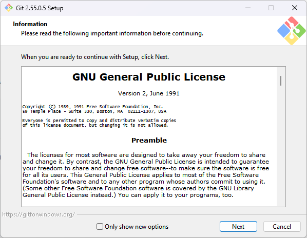
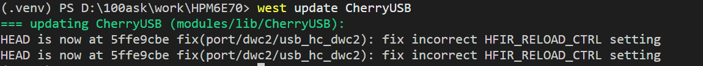
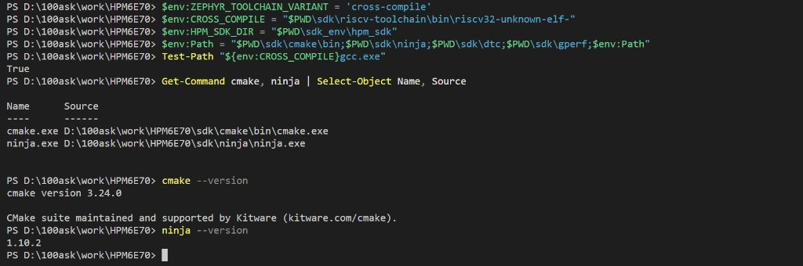

# 第 1 课：搭建 SDK Glue 工作区

HPM6E70 的 Zephyr 开发环境由多部分组成：Zephyr 内核提供操作系统能力，SDK Glue 连接 Zephyr 与 HPMicro 平台，HPM SDK 提供芯片支持，RISC-V 工具链负责生成固件。本课先从空目录准备好 Git、uv、Python 3.12 虚拟环境与 `west`，再建立 `platform/` 清单仓库并用 `west` 把其余部分组合成完整工作区，最终结构与一、二期完整工程包一致。

本课操作依据：[HPMicro《Zephyr SDK Glue 开发指南》](https://kb.hpmicro.com/2025/12/03/zephyr-zephyr-sdk-glue-%E5%BC%80%E5%8F%91%E6%8C%87%E5%8D%97/#windows-%E7%8E%AF%E5%A2%83%E6%90%AD%E5%BB%BA)。

如果你只想直接使用现成工程包学习驱动与外设开发，无需执行本课，直接参考 [获取源码与编译烧录](../start-04-获取源码与编译烧录/README.md) 即可。

## 认识 west：工作区管理工具

`west` 是 Zephyr 官方提供的**工作区管理工具**。可以把它理解为“工程总管”：Git 负责下载某一个代码仓库，而 west 按照一份清单（`platform/west.yml`）一次性下载并管理 Zephyr、HPMicro 适配层、HPM SDK 等多个相互配合的仓库，还能调用构建、烧录命令。

因此，west 不是编译器，也不是芯片驱动：

| 工具 | 负责什么 |
| --- | --- |
| Git | 下载和管理单个代码仓库 |
| west | 按清单组织多个仓库，并提供 `build`、`flash` 等开发命令 |
| CMake + Ninja | 生成并执行 C/C++ 构建过程 |
| RISC-V GCC | 把源代码编译成 HPM6E70 能运行的固件 |

本课执行 `west init`、`west update` 后，west 会根据清单把完整源码放入工作区；后续课程执行 `west build` 时，west 再把应用、Board 和工具链串起来。你不需要手工猜测每个仓库应该放在哪里。

:::info[完成后的可见结果]
`west list zephyr sdk_glue sdk_env` 能列出三部分的版本和目录；工作区中能够看到 `.west/`、`platform/`、`zephyr/`、`sdk_glue/`、`sdk_env/` 和 `sdk/`；RISC-V 编译器文件检查结果为 `True`。
:::

## 目标工作区目录

本教程使用下面的工作区：

```text
D:\100ask\work\HPM6E70
```

环境完成后，各目录的作用如下：

| 目录 | 内容 |
| --- | --- |
| `.west/` | west 工作区配置，manifest 指向 `platform/` |
| `platform/` | 本课程的清单仓库 + Zephyr 模块（板卡、驱动、绑定、公共头） |
| `applications/` | 可以分别构建和运行的应用 |
| `sdk_glue/` | HPMicro 的 Zephyr 适配层和 west 清单 |
| `zephyr/` | Zephyr 源码 |
| `sdk_env/` | HPM SDK 源码 |
| `sdk/` | 随包工具链：RISC-V GCC、CMake、Ninja、OpenOCD、dtc、gperf |
| `.venv/` | 本工程使用的 Python、west 和 Python 包 |

## 开始前准备（Git、uv 与 west）

三期需要从空目录亲手拉取上游源码。如果你已经安装好 Git、uv、Python 3.12 虚拟环境与 `west==1.5.0`，可直接跳到“第一步：建立 platform 清单仓库”；否则先按下面五步准备基础工具：

### 1. 创建工程目录

在计划存放工程的**父目录**打开 Windows PowerShell（建议使用短纯英文路径，如 `D:\work\`，避免中文、空格或覆盖已有工程包）：

```powershell
New-Item -ItemType Directory -Path .\HPM6E70 -Force
Set-Location .\HPM6E70
Get-Location
```

### 2. 安装 Git

下载 [Git 64 位安装程序（Git 2.55.0.5）](https://repo.huaweicloud.com/git-for-windows/v2.55.0.windows.5/Git-2.55.0.5-64-bit.exe)，双击运行并按默认选项安装完成：



安装完成后重新打开一个普通 Windows PowerShell，进入工程目录并确认：

```powershell
git --version
```

### 3. 安装 uv

`uv` 用于自动下载 Python 3.12 并创建工程独立虚拟环境 `.venv`，无需事先安装系统 Python。在工程根目录的 PowerShell 中执行：

```powershell
$uvWheel = Join-Path $env:TEMP 'uv-0.9.9-py3-none-win_amd64.whl'
Invoke-WebRequest -Uri 'https://pypi.tuna.tsinghua.edu.cn/packages/f2/38/562295348cf2eb567fd5ea44512a645ea5bec2661a7e07b7f14fda54cb07/uv-0.9.9-py3-none-win_amd64.whl' -OutFile $uvWheel

$uvExtract = Join-Path $env:TEMP ('uv-extract-' + [guid]::NewGuid().ToString('N'))
New-Item -ItemType Directory -Path $uvExtract | Out-Null
tar -xf $uvWheel -C $uvExtract

$uvBin = Join-Path $env:USERPROFILE '.local\bin'
New-Item -ItemType Directory -Path $uvBin -Force | Out-Null
Copy-Item (Join-Path $uvExtract 'uv-0.9.9.data\scripts\uv.exe') (Join-Path $uvBin 'uv.exe') -Force
$env:Path = "$uvBin;$env:Path"

uv --version
Get-Command uv | Select-Object Source
```

确认输出 `uv 0.9.9` 且路径指向当前用户目录下的 `.local\bin\uv.exe`。

### 4. 创建 Python 3.12 虚拟环境

在同一个 PowerShell 窗口中依次执行：

```powershell
uv python install 3.12 --mirror https://registry.npmmirror.com/-/binary/python-build-standalone/ --no-registry
uv venv --python 3.12 --seed .venv
Set-ExecutionPolicy Bypass -Scope Process -Force
.\.venv\Scripts\Activate.ps1
```

看到命令提示符前出现 `(.venv)` 表示已进入当前工程虚拟环境。

### 5. 安装 west

确认提示符前带有 `(.venv)` 后安装 `west==1.5.0` 并校验全部工具版本：

```powershell
python -m pip install -i https://pypi.tuna.tsinghua.edu.cn/simple west==1.5.0
git --version
uv --version
west --version
```

三条命令均返回版本号后，即可继续下面的工作区初始化步骤。CMake、Ninja 和交叉编译工具链将在下文由 `west update` 自动下载，无需单独安装。

## 第一步：建立 platform 清单仓库

先让当前终端使用 UTF-8：

```powershell
$env:PYTHONUTF8 = '1'
```

`platform/` 既是 west 清单仓库，也是 Zephyr 模块。先创建目录和清单文件：

```powershell
New-Item -ItemType Directory -Path .\platform\zephyr -Force
```

在 `platform/west.yml` 写入：

```yaml
manifest:
  remotes:
    - name: gitee
      url-base: https://gitee.com/hpmicro

  projects:
    - name: sdk_glue
      remote: gitee
      repo-path: zephyr_sdk_glue
      path: sdk_glue
      revision: 1756cb8fbef2334d9ad89aef08a01233f8502919
      import:
        file: west_gitee.yml
        name-blocklist:
          - mcuboot
      west-commands: scripts/west-commands.yml
```

注意远端仓库名是 `zephyr_sdk_glue`，本地目录仍叫 `sdk_glue`；`name-blocklist` 排除本工程不使用的 mcuboot。

再在 `platform/zephyr/module.yml` 写入模块入口，让 Zephyr 从 `platform/` 查找板卡与设备树：

```yaml
name: dshanmcu
build:
  settings:
    board_root: .
    dts_root: .
```

`board_root`/`dts_root` 的 `.` 相对模块根目录（即 `platform/`）。后续课程把 Board 文件放进 `platform/boards/`、绑定放进 `platform/dts/bindings/`，Zephyr 就能自动发现，不需要在命令行重复传 `--board-root`。等加入自研驱动后（二期第 7 课），再给这个文件补上 `cmake:` 与 `kconfig:` 入口。

## 第二步：初始化并下载工作区

确认当前终端位于工程根目录后，用本地清单初始化：

```powershell
west init -l platform
```

`west init -l` 生成 `.west/config`，记录 `path = platform`、`file = west.yml`。然后下载各个仓库：

```powershell
west update
```

west 先克隆 `sdk_glue` 并读取它导入的 `west_gitee.yml`，再据此克隆 Zephyr、HPM SDK 与其余模块。

### `CherryUSB` 更新失败时如何恢复

`west update` 会按清单逐个更新仓库。某个仓库失败时，前面已经显示 `HEAD is now at ...` 的仓库仍然有效，不需要全部重新下载。

如果命令最后显示：

```text
ERROR: update failed for project CherryUSB
```

先确认清单中的路径：

```powershell
west list CherryUSB
```

本工程中 `CherryUSB` 的目录是 `modules/lib/CherryUSB`。先在工程根目录重试该项目：

```powershell
west update CherryUSB
```

如果仍然失败，强制重新获取该项目：

```powershell
west update -f always CherryUSB
```

如果仓库已经创建但只有 `.git` 目录，说明源码提交还没有拉取完整。清单为 `CherryUSB` 指定的提交是 `5ffe9cbe7fb41489d99806daa8572124ace1b99b`，可以直接从清单配置的 `cherry-embedded` 远程补齐：

```powershell
git -C .\modules\lib\CherryUSB fetch cherry-embedded 5ffe9cbe7fb41489d99806daa8572124ace1b99b
west update CherryUSB
```

成功时会看到类似下面的结果：

```text
HEAD is now at 5ffe9cbe fix(port/dwc2/usb_hc_dwc2): fix incorrect HFIR_RELOAD_CTRL setting
```



图中 `HEAD is now at 5ffe9cbe` 表示 `CherryUSB` 已切换到清单要求的版本；命令返回提示符且没有新的 `ERROR` 时，才继续执行下一步。

下载完成后，工作区应至少包含：

```text
HPM6E70/
├─ .venv/
├─ .west/
├─ platform/
├─ modules/
├─ sdk_env/
├─ sdk_glue/
└─ zephyr/
```

检查清单配置：

```powershell
Get-Content .\.west\config
```

其中应看到：

```ini
[manifest]
path = platform
file = west.yml
```

## 第三步：安装 Zephyr 依赖并应用 HPM SDK 补丁

`west update` 完成后，确认终端提示符前有 `(.venv)`，然后按下面的顺序逐条执行。

### 3.1 安装 Zephyr 的 Python 依赖

```powershell
python -m pip install -i https://pypi.tuna.tsinghua.edu.cn/simple -r .\zephyr\scripts\requirements.txt
```

这条命令只负责把 Zephyr 构建所需的 Python 包安装到当前工程的 `.venv` 中。

### 3.2 检查依赖是否完整

```powershell
python -m pip check
```

看到 `No broken requirements found.` 表示依赖关系没有缺失。本课程**不往 venv 安装 Ninja**（它由 `sdk/` 提供）。

### 3.3 注册 Zephyr 工程

```powershell
west zephyr-export
```

该命令把当前工作区的 Zephyr CMake 包注册到用户环境中，使后续 CMake 配置能够找到 Zephyr。

### 3.4 应用 HPM SDK 补丁

```powershell
west supply
```

该命令根据清单把 HPM SDK 补丁应用到 `sdk_env\hpm_sdk\`，其中包括 RTL8201 网口与显示枚举两处修复。正常完成时，命令返回提示符且没有出现 `patched ... failed` 或 `ERROR`。

#### Windows 下补丁换行符不一致时

如果输出：

```text
0002-fix-enet-phy-rtl8211.patch patched in ...\sdk_env\hpm_sdk failed
```

这是补丁文件与 HPM SDK 源文件的换行符不同导致的检查失败。如果错误只指向这个 `0002` 补丁，前面的补丁已经完成，不要重复执行整个命令。保持当前目录为工程根目录，直接应用第二个补丁：

```powershell
git -C .\sdk_env\hpm_sdk apply --ignore-whitespace ..\..\sdk_glue\scripts\patch\hpm_sdk_v1.11.0\0002-fix-enet-phy-rtl8211.patch
```

检查补丁是否已经写入：

```powershell
Select-String .\sdk_env\hpm_sdk\components\enet_phy\rtl8201\hpm_rtl8201.h -Pattern media_interface
```

输出包含 `uint8_t media_interface;` 后，表示补丁已完成。

## 第四步：把工具集中到 sdk/ 并选择工具链

`west update` 把 RISC-V 工具链、CMake、Ninja 放在 `sdk_env/` 里。为与一、二期工程包一致，把它们集中到 `sdk/`：

```powershell
New-Item -ItemType Directory -Path .\sdk -Force
Move-Item .\sdk_env\toolchains\rv32imac_zicsr_zifencei_multilib_b_ext-win .\sdk\riscv-toolchain
Move-Item .\sdk_env\tools\cmake .\sdk\cmake
Move-Item .\sdk_env\tools\ninja .\sdk\ninja
```

适配 JTAG 烧录调试接口的随包 OpenOCD、dtc、gperf 与调试器驱动安装包（driver）不在 `west update` 的下载内容里，从课程资料包取得后分别放入 `sdk\openocd\`、`sdk\dtc\`、`sdk\gperf\`、`sdk\driver\`。

然后在当前终端逐行执行：

```powershell
$env:ZEPHYR_TOOLCHAIN_VARIANT = 'cross-compile'
$env:CROSS_COMPILE = "$PWD\sdk\riscv-toolchain\bin\riscv32-unknown-elf-"
$env:HPM_SDK_DIR = "$PWD\sdk_env\hpm_sdk"
$env:Path = "$PWD\sdk\cmake\bin;$PWD\sdk\ninja;$PWD\sdk\dtc;$PWD\sdk\gperf;$env:Path"
```

最后一行把 `sdk/` 里的 CMake、Ninja、dtc、gperf 放到 PATH 最前面，后续 `west build` 固定使用这些版本，不受系统安装影响。

检查文件确实存在：

```powershell
Test-Path "${env:CROSS_COMPILE}gcc.exe"
Get-Command cmake, ninja | Select-Object Name, Source
cmake --version
ninja --version
```

第一条应输出 `True`；`Get-Command` 显示的 CMake 和 Ninja 路径都应位于当前工程的 `sdk/`。



## 每次新建 Windows PowerShell 都要做什么

虚拟环境和下载内容会一直保留，不需要重新安装。在**三期从零自建工作区**中，每次打开新的 Windows PowerShell 后，进入工作区并重新设置当前终端（如果直接使用随课程分发的 `HPM6E70` 完整工程包，`.venv\Scripts\` 中是原生启动器，没有 `Activate.ps1`，直接执行 `.\.venv\Scripts\west.exe` 即可）：

```powershell
Set-Location D:\100ask\work\HPM6E70
Set-ExecutionPolicy -Scope Process Bypass
.\.venv\Scripts\Activate.ps1
$env:PYTHONUTF8 = '1'
$env:ZEPHYR_TOOLCHAIN_VARIANT = 'cross-compile'
$env:CROSS_COMPILE = "$PWD\sdk\riscv-toolchain\bin\riscv32-unknown-elf-"
$env:HPM_SDK_DIR = "$PWD\sdk_env\hpm_sdk"
$env:Path = "$PWD\sdk\cmake\bin;$PWD\sdk\ninja;$PWD\sdk\dtc;$PWD\sdk\gperf;$env:Path"
```

最后检查：

```powershell
python --version
west --version
west list zephyr sdk_env sdk_glue
```

此时 Zephyr SDK Glue 开发环境已经准备完成，结构与一、二期完整工程包一致。后续课程中的 PowerShell 命令默认都在完成这一节的终端中执行。