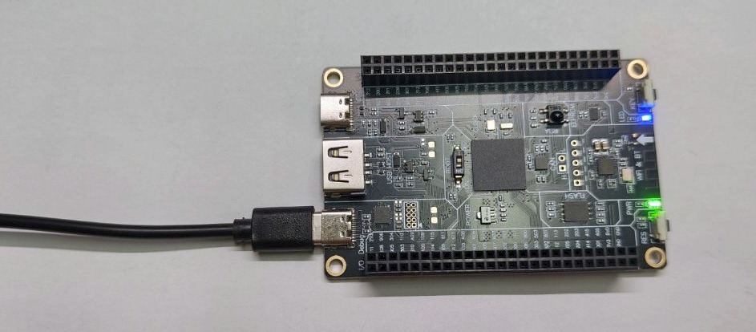
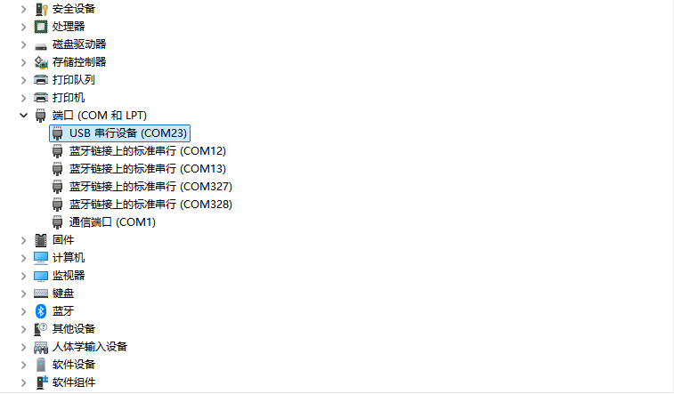

# 连接开发板与确认串口

**DShanMCU RA6M5** 开发板已经板载了 WCH-Link 调试器、LED、按键和 EEPROM，不需要外接调试器，也不用插任何杜邦线——准备**开发板**和**一根支持数据传输的 USB Type-C 线**，按下面两步完成连接与串口确认即可。

## 第一步：用一根 Type-C 线连接 Debug 口

1. 先核对板子中部的 **`BOOT`** 拨码开关已经拨到 **`OFF`** 一侧；
2. 将支持数据传输的 USB Type-C 线插入左下方丝印为 **`Debug`** 的接口，另一端接入 Windows 电脑 USB 口；
3. 确认右侧 **`PWR`** 绿色电源灯点亮（若板内已有示例程序，上方蓝色 `LED / D12` 也会亮起或闪烁）：

实物连接参考：USB Type-C 线插入左下侧 Debug 口（勿插左上侧 OTG 口），上电后右侧绿色 PWR 灯点亮。

:::caution[不要插错成 OTG 口]
开发板左侧上方还有一个丝印为 **`OTG`** 的 Type-C 口，它用于后续 USB 应用，**不能代替 `Debug` 口完成烧录与串口日志**。另外请勿使用仅能充电的 USB 线。
:::

## 第二步：在设备管理器确认板载串口 {#确认电脑识别到开发板}

右键桌面「开始」菜单打开 Windows **设备管理器**，展开 **端口（COM 和 LPT）**：

展开“端口（COM 和 LPT）”查看板载 USB 串口（图中 COM23 仅为示例，请以本机实际分配的 COM 号为准）。

1. 拔插一次开发板 USB 线，观察列表中随之出现/消失的 **USB 串行设备（COMx）**，记下这个 COM 编号（列表中「蓝牙链接上的标准串行」等属于其他设备，不要选错）；
2. 板载 WCH-Link 使用标准 USB CDC 串口，Windows 10/11 通常会自动加载系统自带驱动；只要端口下出现正常 COM 口、没有黄色感叹号，就无需手动装驱动。

:::note[如果设备管理器出现黄色感叹号]
说明系统未自动匹配 WCH-Link 串口驱动，请从沁恒官网下载安装：

- [WCH-Link 配套工具与驱动下载](https://www.wch.cn/downloads/WCH-LinkUtility_ZIP.html)
- [WCH-Link 使用说明](https://www.wch.cn/downloads/WCH-LinkUserManual_PDF.html)（查看“驱动安装”章节中的 **CDC 驱动 / `WCHLinkSER`** 说明）

安装完成后重新插拔 USB 线，确认「端口（COM 和 LPT）」下出现正常 COM 口即可。
:::

硬件原理图、位号图与芯片参考入口

- 开发板完整位号图：[查看完整位号图 PDF](pathname:///files/ra6m5/ra6m5-assembly.pdf)（其中左上角 `UART&DAP` 对应实物板 `Debug` 口）
- 开发板完整硬件资料：[百问网 RA6M5 资料页面](https://download.100ask.net/boards/Renesas/DShanMCU-RA6M5/index.html)
- 主芯片参数、官方功能框图与板载外设接口：[RA6M5 芯片与硬件](/docs/ra6m5/reference/hardware/)
- 9 个板载配套示例功能总览：[配套示例详解](/docs/ra6m5/reference/examples/)

---

[课程首页](/docs/ra6m5/) · [下一步：获取工程与配置 VS Code](../02-配置VSCode开发环境/README.md)
