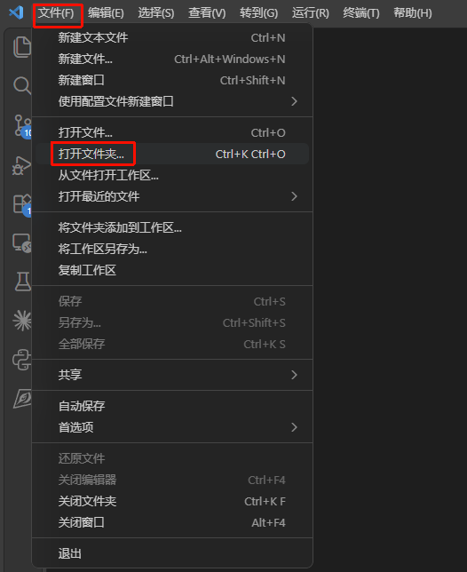
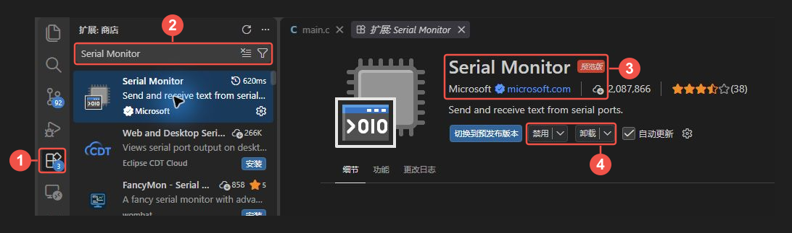
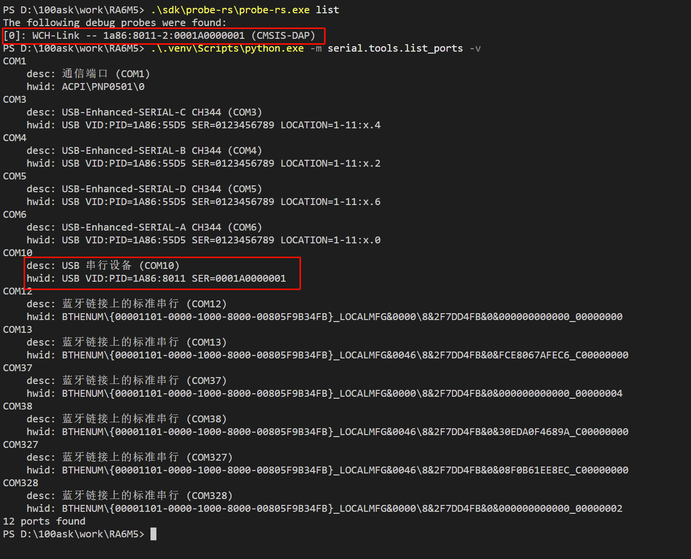

# 获取工程与配置 VS Code

硬件串口已经识别后，接下来下载 **RA6M5 完整课程工程包**，用 VS Code 打开工程并安装两项必备扩展，最后在终端确认烧录器与串口全部就绪。

**工程包已随包内置全部开发工具**（Python、CMake、Ninja、Git、Arm GNU 编译器、probe-rs 与 `west`），**无需单独搭建 Zephyr 工具链或配置系统环境变量**。

## 第一步：下载并解压课程工程

1. 从百度网盘下载 **RA6M5 完整课程工程包**（压缩包约 2.0 GB）：
   - 下载地址：[RA6M5 Zephyr 完整课程工程（百度网盘）](https://pan.baidu.com/s/12Jvgj1c3axk7P83eyjcnKg?pwd=jam7)
   - 提取码：`jam7`
2. 将压缩包完整解压到**不包含中文和空格的短路径**，例如 `D:\work\RA6M5\`（避免解压到桌面、中文目录或过深路径）。

解压完成后，打开 `RA6M5` 根目录，确认包含以下核心目录即可（请保持相对位置不变，不要单独移动 `.venv` 或 `sdk`）：

| 目录 | 作用 |
| --- | --- |
| `.venv/` | 随包命令行启动器（`python.exe`、`west.exe`），自动关联 `sdk/` 工具链 |
| `.vscode/` | 随工程提供的 VS Code 终端环境、扩展推荐与代码索引配置 |
| `.west/` | `west` 工作区配置，指向 `platform/west.yml` |
| `applications/` | 9 个可独立编译运行的 Zephyr 示例应用（含 `board_bringup` 等） |
| `platform/` | RA6M5 板卡定义、自研驱动、设备树 Binding 与烧录 runner |
| `sdk/`、`zephyr/`、`modules/` | 内置 Arm 工具链/probe-rs、Zephyr v4.4.2 内核与依赖模块 |

## 第二步：用 VS Code 打开 RA6M5 根目录

如果电脑还没有安装 VS Code，先前往 [VS Code 官方下载页](https://code.visualstudio.com/download) 下载 **Windows → User Installer → x64**（普通 64 位 Windows 电脑均选 x64，不要误选 Arm64）并按向导安装完成。

启动 VS Code 后，点击顶部菜单 **文件（File） → 打开文件夹…（Open Folder…）**，选中解压后的 **`RA6M5`** 根目录：

[](./images/vscode-open-folder.png)

<p className="image-caption">在“文件”菜单点击“打开文件夹…”，选中包含 applications、platform 和 .west 的 RA6M5 根目录。</p>

打开后看左侧「资源管理器（Explorer）」确认目录层级正确（`sdk` 与 `.venv` 默认被工程配置隐藏，属于正常现象，不影响终端调用）：

<a href={require('./images/vscode-workspace-root.png').default}></a>

<p className="image-caption">确认打开的是最外层 RA6M5 根目录；如弹出“是否信任此文件夹中文件的作者”，请选择信任。</p>

:::caution[一定要打开整个 RA6M5 根目录]
不要只打开 `applications/board_bringup` 或单个 `main.c`，否则 `.vscode/` 中的终端环境与代码索引配置不会加载。
:::

## 第三步：安装两项扩展 {#安装工程使用的两项扩展}

按 **`Ctrl + Shift + X`** 打开左侧「扩展（Extensions）」，安装下面两项由 **Microsoft** 发布的扩展（也可以在搜索框输入 `@recommended` 直接从工作区推荐列表查看）：

| 扩展名称（发布者：Microsoft） | 搜索关键词 / 完整 ID | 用途 |
| --- | --- | --- |
| [C/C++](https://marketplace.visualstudio.com/items?itemName=ms-vscode.cpptools) | `@id:ms-vscode.cpptools` | C 代码补全、函数跳转与语法提示 |
| [Serial Monitor](https://marketplace.visualstudio.com/items?itemName=ms-vscode.vscode-serial-monitor) | `@id:ms-vscode.vscode-serial-monitor` | 在 VS Code 底部面板直接查看串口日志 |

以 **Serial Monitor** 为例，对照图中标号 `1`～`4` 确认安装状态：

[](./images/vscode-serial-plugin-install.png)

1. 点击左侧 **扩展图标**（图中标号 `1`）；
2. 在顶部 **搜索框** 输入 `Serial Monitor` 或表中的完整 ID（标号 `2`）；
3. 核对扩展名称为 **Serial Monitor**、发布者为 **Microsoft**（标号 `3`）；
4. 未安装时点击 **安装（Install）**；若已显示「禁用 / 卸载」说明安装就绪（标号 `4`）。

用同样的方法安装并确认 **C/C++** 扩展。烧录工具 **probe-rs** 已内置在 `sdk/probe-rs/` 中，无需额外安装烧录扩展。

## 第四步：在终端检测烧录器与串口

保持开发板通过 **`Debug`** 接口连在电脑上。在 VS Code 顶部点击 **终端（Terminal） → 新建终端（New Terminal）**（窗口较窄时先点菜单栏里的 **`...`**），确认打开的是 **PowerShell** 且当前路径位于 `RA6M5` 根目录。

依次执行以下两条命令，确认工程工具能枚举到板载烧录器和串口：

```powershell
.\sdk\probe-rs\probe-rs.exe list
.\.venv\Scripts\python.exe -m serial.tools.list_ports -v
```

对照下图核对输出：

[](./images/vscode-probe-and-serial-check.png)

- 第一条命令应列出 **`WCH-Link`**，包含 **`1a86:8011`** 与 **`CMSIS-DAP`**；
- 第二条命令应找到 **`VID:PID=1A86:8011`** 的 USB 串行设备，记下它的 COM 编号（以本机实际分配为准）。

## 常见问题排查

| 现象 | 解决方法 |
| --- | --- |
| 提示找不到命令或文件 | 确认终端当前路径在 `RA6M5` 根目录，且 `.venv`、`sdk` 已完整解压 |
| `probe-rs list` 没有列出 `WCH-Link` | 检查 Type-C 线是否插在 **`Debug`** 口（而非 `OTG`）、线缆是否支持数据传输、开发板 `PWR` 灯是否点亮 |
| 列表里没有 `VID:PID=1A86:8011` 串口 | 回到 [连接开发板与确认串口](../01-准备工程与连接开发板/README.md#确认电脑识别到开发板) 检查设备管理器与 WCH 串口驱动 |

<details>
<summary>补充说明：`.vscode/` 内置配置与首次打开时的红色波浪线</summary>

工程自带的 `.vscode/` 包含三个预配置文件，无需手动新建：

| 文件 | 作用 |
| --- | --- |
| `extensions.json` | 声明 `C/C++` 与 `Serial Monitor` 两项工作区推荐扩展 |
| `settings.json` | 自动配置 VS Code 终端环境变量，并隐藏庞大的 `sdk/`、`.venv/` 目录 |
| `c_cpp_properties.json` | 让 C/C++ 扩展读取工程内 Arm 编译器与 `build/compile_commands.json` 代码索引 |

- **关于红色波浪线**：首次编译前尚未生成 `build/compile_commands.json`，C/C++ 扩展可能暂时报头文件找不到。完成下一篇首次 `west build` 后索引会自动更新，无需手动处理。
- **不要点右上角「运行 C/C++ 文件」**：Zephyr 工程统一通过终端 `west build` 完整构建。

</details>

---

[上一步：连接开发板与确认串口](../01-准备工程与连接开发板/README.md) · [下一步：编译烧录第一个闪灯程序](../03-编译与烧录程序/README.md)
