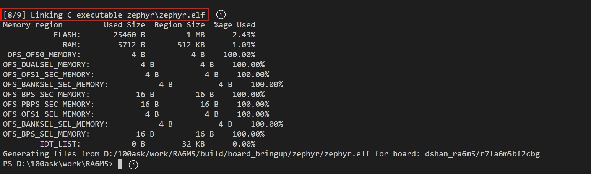
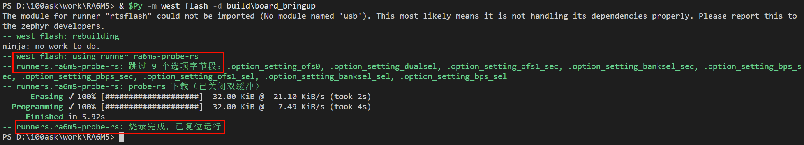
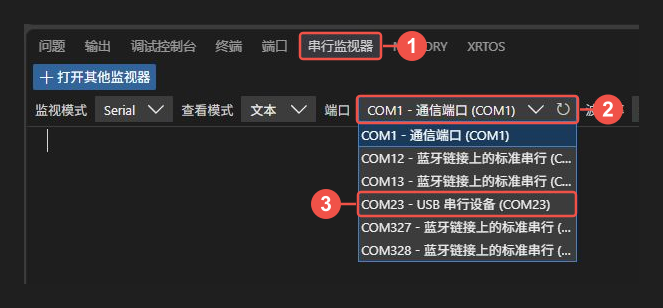
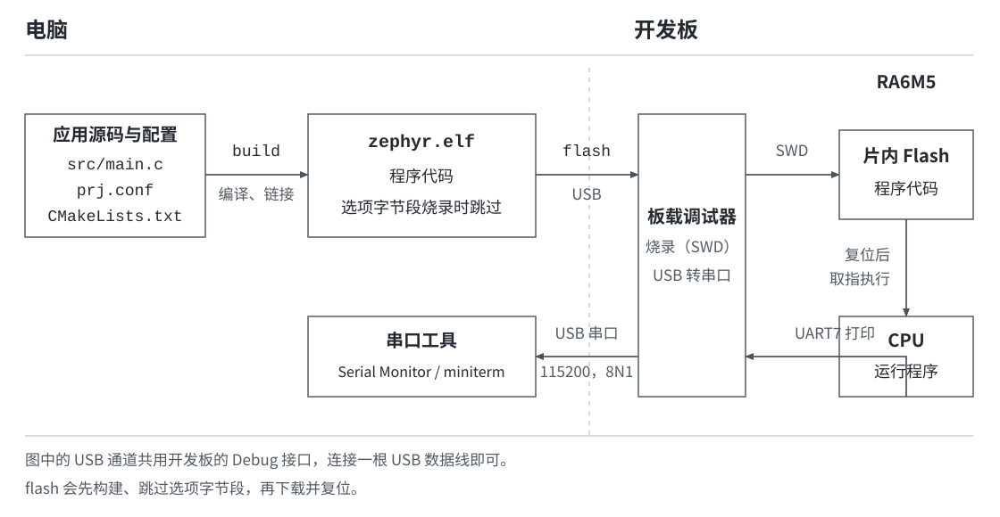

# 编译烧录第一个闪灯程序

工程与 VS Code 已经就绪。接下来用 `board_bringup` 示例走完一次完整的 **编译 → 烧录 → 观察闪灯与串口日志**，验证整套开发链路完全畅通。

确认 VS Code 已打开 **`RA6M5` 根目录**，并在底部打开了 **PowerShell 终端**（提示符位于 `RA6M5` 根目录）。

## 第一步：编译 `board_bringup` 工程

在 VS Code 的 PowerShell 终端中执行：

```powershell
.\.venv\Scripts\python.exe -m west build -b dshan_ra6m5 applications\board_bringup -d build\board_bringup
```

| 参数 | 作用 |
| --- | --- |
| `.\.venv\Scripts\python.exe` | 工程内置启动器，自动关联随包工具链（**不要用系统 `python` / `west`**） |
| `-b dshan_ra6m5` | 指定目标板卡 |
| `applications\board_bringup` | 要编译的应用源码目录 |
| `-d build\board_bringup` | 独立构建输出目录，避免多个应用互相覆盖缓存 |

等待命令结束，按图中标号 `1`、`2` 核对编译结果：

[](./images/vscode-build-result.png)

1. 看到 **`Linking C executable zephyr\zephyr.elf`** 与下方的 **`Memory region`**（FLASH / RAM 占用表）且无报错（标号 `1`）；
2. 终端重新回到输入提示符，说明构建完成且代码索引已自动刷新（标号 `2`）。

> 提示：二次运行若源码未修改，终端输出 `ninja: no work to do.` 属于正常增量跳过；修改 `prj.conf` 或 `.overlay` 后如需强制重建，在 `west build` 后加 `-p always` 即可。

## 第二步：烧录并观察 D12 闪烁

确认 USB Type-C 线连接板上的 **`Debug`** 接口且 **`BOOT` 为 `OFF`**，在终端执行：

```powershell
.\.venv\Scripts\python.exe -m west flash -d build\board_bringup
```

`west flash` 会先自动检查是否需要增量编译，随后调用工程内置的 `probe-rs` runner 自动跳过 RA 选项字节段并下载复位。看到以下输出即烧录成功：

[](./images/vscode-flash-result.png)

- 终端先显示 **`跳过 9 个选项字节段`** 与擦除/编程进度，最后打印 **`烧录完成，已复位运行`**；
- 此时观察开发板右侧的 **`LED (D12)`**，应每隔约 **500 ms** 周期性亮灭闪烁。

## 第三步：查看串口启动日志

确认 D12 闪烁后，打开串口查看启动日志（参数统一为 **`115200 8N1`**，端口选择此前查到的 **`VID:PID=1A86:8011`** 对应 COM 口）。下面提供两种查看方式，任选其一即可（切换前请先关闭当前占用的串口连接）：

### 方式一：使用 VS Code `Serial Monitor`

1. **打开面板并选端口**（对照图中标号 `1`～`3`）：展开 VS Code 底部面板切到 **串行监视器**（标号 `1`），保持 `Serial` 与 `文本` 模式，展开 **端口** 下拉框（标号 `2`）选中开发板对应 COM 口（标号 `3`，若刚插线请先点右侧刷新图标）：

[](./images/vscode-serial-plugin-port.png)

2. **核对参数并开始监视**（对照图中标号 `1`～`4`）：波特率选 **`115200`**（标号 `1`），点齿轮展开「其他设置」（标号 `2`）确认 **数据位 `8`、停止位 `1`、奇偶校验 `无`**（标号 `3`），点击 **开始监视**（标号 `4`）：

[](./images/vscode-serial-plugin-settings.png)

3. **按 `RES` 查看日志**：看到「已打开串行端口」后，按一下开发板右下角的 **`RES`** 复位键，输出区会打印 Zephyr 启动横幅与 `Dshan RA6M5 bring-up:` 行（标号 `1`）；查看完毕点击 **停止监视**（标号 `2`）释放串口：

[](./images/vscode-serial-plugin-output.png)

### 方式二：使用终端 `miniterm`

也可以直接调用工程内置的 `miniterm` 在终端看日志（把下面命令中的 `COM23` 换成你电脑实际识别的编号，默认即为 `115200 8N1`）：

```powershell
.\.venv\Scripts\python.exe -m serial.tools.miniterm COM23 115200
```

终端显示连接提示后，按一下开发板 **`RES`** 复位键，即可看到启动信息与 `Dshan RA6M5 bring-up:` 输出：

[](./images/vscode-serial-output.png)

查看结束后按 **`Ctrl + ]`** 退出 `miniterm` 释放串口（开发板上的程序会继续运行）。

> 说明：`board_bringup` 只在启动时打印一次横幅，随后循环翻转 D12，因此打印完启动行后日志区不再刷屏属于正常现象；想重新看一次时保持串口连接再按 **`RES`** 即可。

## 常见问题排查

| 现象 | 可能原因 | 解决方法 |
| --- | --- | --- |
| 报错找不到 `west` 或工具链 | 使用了系统 `python` / `west` 或路径不在根目录 | 确认终端位于 `RA6M5` 根目录，严格使用 `.\.venv\Scripts\python.exe -m west ...` |
| `west flash` 找不到烧录器或下载超时 | 线插在 `OTG` 口、`BOOT` 未拨到 `OFF` 或数据线接触不良 | 核对 USB 接 **`Debug`** 口、**`BOOT = OFF`**，重插后用 `.\sdk\probe-rs\probe-rs.exe list` 确认 |
| 打开串口提示「拒绝访问 / 端口被占用」 | 另一个串口工具或监视面板未断开 | 先在 Serial Monitor 点 **停止监视**（或在 `miniterm` 按 `Ctrl + ]`）再重新打开 |
| 打开串口后一片空白 | 烧录完才开串口（错过了启动打印）或选错 COM 口 | 保持串口打开后按一下开发板 **`RES`** 复位键；确认所选 COM 口对应 `VID:PID=1A86:8011` |

<details>
<summary>补充参考：编译产物目录、整体流程与常用命令速查</summary>

编译 `board_bringup` 后，输出位于 `build/board_bringup/`：

```text
build/board_bringup/
├─ compile_commands.json   # 供 VS Code C/C++ 扩展跳转补全
└─ zephyr/
   ├─ zephyr.elf           # 烧录程序与调试符号
   ├─ zephyr.dts           # 本次构建合并后的最终设备树
   └─ .config              # 本次构建最终生效的 Kconfig 配置
```



后续切换编译 `applications/` 下其他示例时，只需替换应用名即可：

| 操作 | 工程根目录 PowerShell 命令 |
| --- | --- |
| 增量编译 | `.\.venv\Scripts\python.exe -m west build -b dshan_ra6m5 applications\<应用名> -d build\<应用名>` |
| 强制全量重建 | `.\.venv\Scripts\python.exe -m west build -p always -b dshan_ra6m5 applications\<应用名> -d build\<应用名>` |
| 自动编译并烧录复位 | `.\.venv\Scripts\python.exe -m west flash -d build\<应用名>` |
| 终端串口监视 | `.\.venv\Scripts\python.exe -m serial.tools.miniterm <COM号> 115200` |

</details>

---

[上一步：获取工程与配置 VS Code](../02-配置VSCode开发环境/README.md) · [进入第 1 章：认识课程工程结构](../../01-Zephyr应用开发/01-认识课程工程结构/README.md) · [查看全部 9 个配套示例](/docs/ra6m5/reference/examples/)
