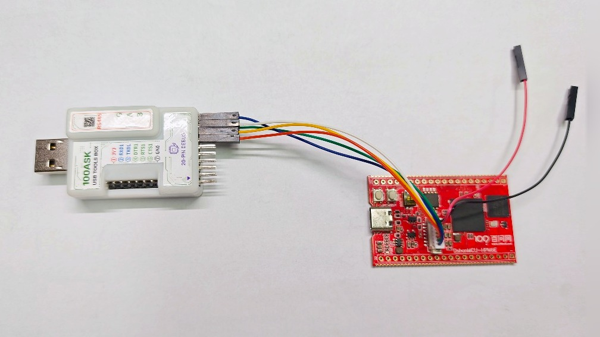
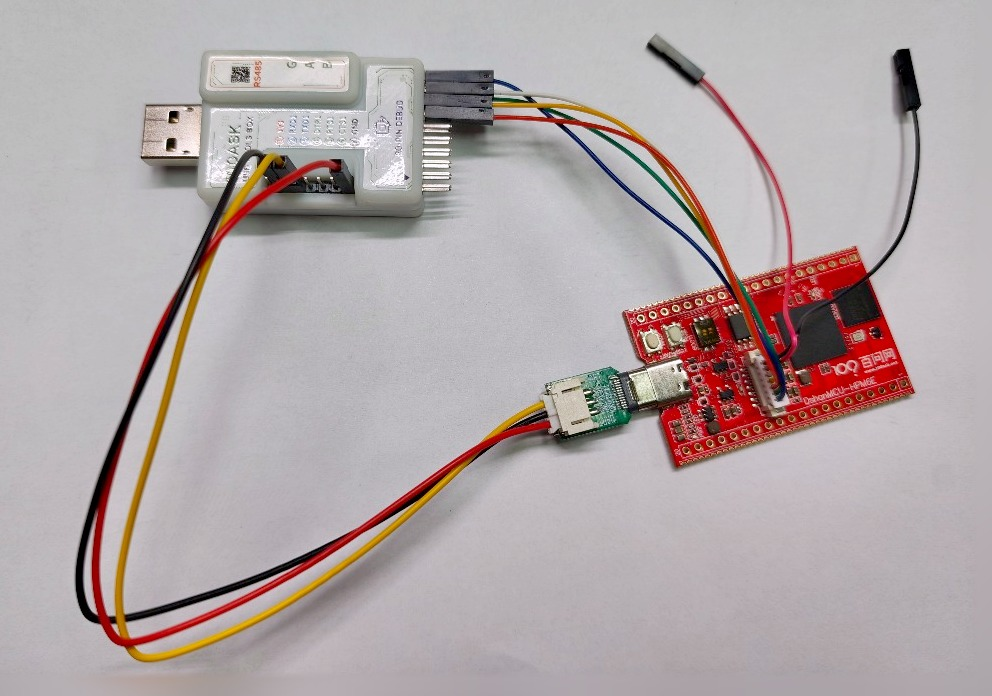
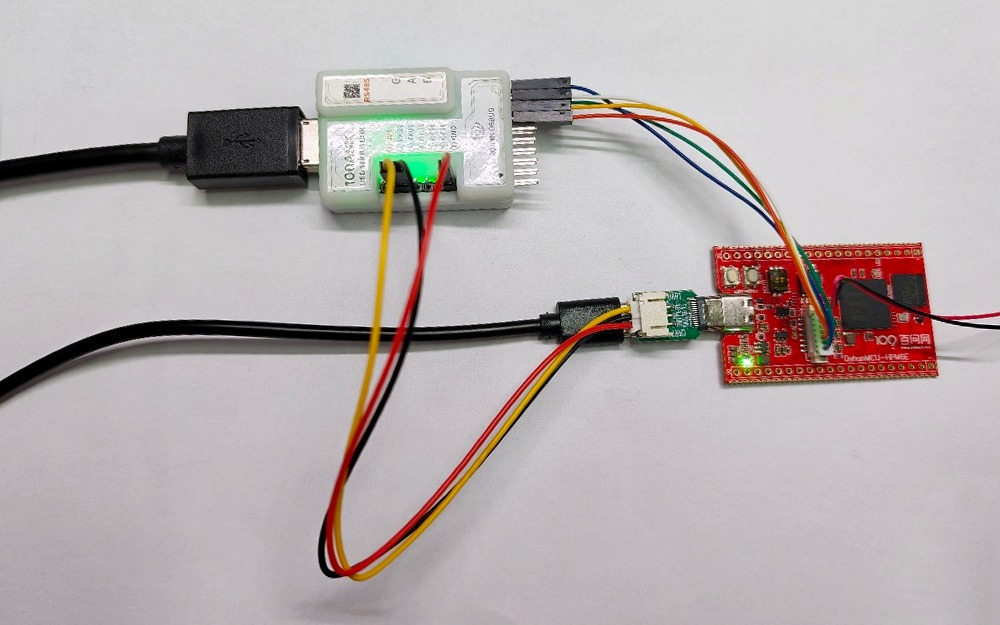

import HardwareWiringGuide from '@site/src/components/HardwareWiringGuide';

# 连接调试器与串口

准备好 **HPM6E70 核心板**、**DshanPI USBToolBox 调试器**、**7-Pin 白色烧录线** 和 **USB-C 串口分线器**，按下面两步顺序依次接完即可（这一步不用插扩展底板）。

:::caution[接线前先断电]
插拔线之前务必先拔掉核心板和调试器的 USB 电源；**不要把两头的 `3.3V` 或 `5V` 电源线连在一起**。
:::

## 第一步：接 JTAG 烧录线（5 根）

先看整体连好后的实物样子——左侧为调试器 20 针口（靠近 `RS485` 一侧的 4 列），右侧为白色 7-Pin 线束插在核心板 `DAPLink` 座子上（右侧悬空的 2 根红/黑电源与复位线留空不插）：

第一步实物参考：仅接 5 根 JTAG 烧录线（靠近 RS485 一侧）；右侧红/黑 2 根线悬空不插，具体针脚看下方 3D 定位图。

对照下方 3D 定位图逐根插线（点右下角 **「下一根 →」** 可以一根一根高亮跟着插）：

<HardwareWiringGuide mode="jtag" />

核心板 USB-C 朝左摆放，认准白色 7-Pin `DAPLink` 座子左上角的 **`▼` 标记** 为第 1 孔（前 2 孔悬空不插）：

| 序号 | 信号 | 核心板白座子（从 `▼` 往下数） | 调试器 20 针口（正对排针、文字朝上） | 背面贴纸编号 |
| --- | --- | --- | --- | --- |
| 1 | **TCK** | 第 5 孔 | 上排右数第 4 针 | `P13 / IO4` |
| 2 | **TDO** | 第 4 孔 | 上排右数第 3 针 | `P15 / IO5` |
| 3 | **TDI** | 第 3 孔 | 上排右数第 2 针 | `P17 / IO6` |
| 4 | **TMS** | 第 6 孔 | 下排右数第 2 针 | `P18 / IO7` |
| 5 | **GND** | 第 7 孔（最下孔） | 最右侧上下任一针 | `P19 / P20` |

## 第二步：接 UART0 串口线（3 根）

保持上面的 JTAG 五线不动，再把 **USB-C 串口分线器** 插到核心板左侧 USB-C 口（白色 3-Pin 座子朝上），引出的 3 根线接到调试器侧面 `UART1` 排针：

第二步实物参考：USB-C 串口分线器白座朝上接入核心板，引出 3 根线连到调试器侧面 UART1（P1 3V3 留空）。

对照下方 3D 定位图逐根插线——**看分线器靠近白色座子（左排）的丝印，按 `RX ↔ TX` 交叉接到调试器 `UART1`**：

<HardwareWiringGuide mode="uart" />

| 序号 | 分线器靠近白座一侧（从圆点 `•` 往下数） | 调试器 `UART1` 排针（外壳丝印 1～7） | 接法说明 |
| --- | --- | --- | --- |
| 1 | 第 1 脚（圆点 `•` · **`RX`**） | **`P3 · TXD1`**（左数第 3 针） | 交叉连接（收接发） |
| 2 | 第 2 脚（中间 · **`TX`**） | **`P2 · RXD1`**（左数第 2 针） | 交叉连接（发接收） |
| 3 | 第 3 脚（最下 · **`GND`**） | **`P7 · GND`**（最右侧第 7 针） | 共地（`P1 3V3` 不接） |

:::tip[分线器防错提醒]
- **看丝印，不要按线色盲猜**：配套 3-Pin 线束中红线通常接在 `GND`（并非电源），切勿按“红正黑负”凭感觉插。
- **白座朝上插**：如果把分线器反面插入核心板 USB-C 口导致串口无输出，拔出翻面重插（或对调 `P2 RXD1` / `P3 TXD1`）即可。
- **供电位置**：5 V USB 供电线直接插在分线器尾部的 USB-C 母口即可同时给核心板供电。
:::

## 第三步：核对并上电

线全部插牢后，按顺序通电：

1. 先核对一遍：**没有**插任何 `3.3V` / `5V` 电源杜邦线，且 5 根 JTAG 线插在调试器 **靠近 `RS485` 的一侧**；
2. 先通过分线器尾部的 USB-C 母口给 **HPM6E70 核心板** 接上 5 V 供电；
3. 再把 **DshanPI USBToolBox 调试器** 插进电脑 USB 口，确认调试器与核心板的绿色电源指示灯均已点亮：

第三步上电验收参考：分线器尾端接入 5 V USB 供电、调试器接入电脑后，两侧绿色指示灯均点亮即正常。

> 如果通电后电脑 USB 反复断开或线缆发热，立即拔掉 USB 重新核对针脚。

补充说明：为什么不用接 3.3V / RST，为什么串口要接 USB-C 分线器？

- **不接 `3.3V`**：核心板和调试器各自通过 USB 独立供电，并接电源容易倒灌损坏器件。
- **不接 `RST`（`P16 SRST`）**：本工程通过 RISC-V 调试模块软件复位，5 根 JTAG 线即可稳定烧录与调试。
- **为什么要 USB-C 分线器**：核心板 USB-C 口的 `SBU1/SBU2` 引出了 `UART0` 串口信号，普通 USB 线无法直接转成电脑 COM 口，需要分线器引出后交给调试器 `UART1`；分线器靠近白座一侧的 `RX / TX` 丝印标的是核心板自身引脚，因此按串口惯例与调试器 `TXD1 / RXD1` 交叉连接即可。

---

[课程目录](../README.md) · [下一步：安装 USBToolBox 与驱动](../start-02-安装USBToolBox与驱动/README.md)
