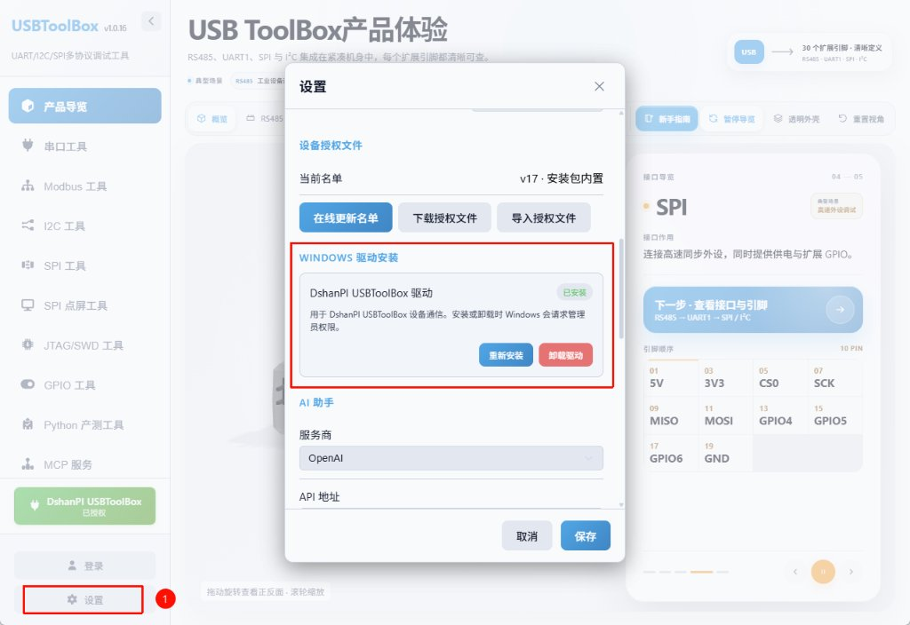
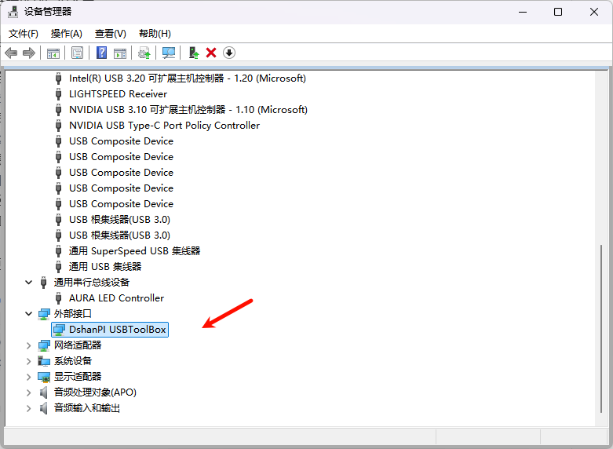

# 安装 USBToolBox 与驱动

`DshanPI USBToolBox` 是配套调试器的桌面工具软件：它既可以直接图形化烧录 `.hex` 固件，也内置了一键安装 Windows 驱动功能。安装完成后，无论是用上位机直接烧录体验固件，还是在命令行里用 `west flash` 烧录源码，都会复用同一套底层驱动。

:::info[本步完成标志]
在 Windows 设备管理器中，**外部接口** 下出现无感叹号的 `DshanPI USBToolBox`（JTAG 烧录调试接口），**端口（COM 和 LPT）** 下出现 `DshanPI USBToolBox UART1 (COMx)`。
:::

## 第一步：下载并安装上位机

1. 打开 [DshanPI USBToolBox 下载目录](https://dl.100ask.net/Tools/usbtoolsbox/)；
2. 下载最新的 Windows 安装程序（文件名类似 `DshanPI USBToolBox_x.x.x_x64-setup.exe`）；
3. 双击安装包，按向导保持默认选项完成安装。

## 第二步：安装调试器驱动

安装完成后启动 `DshanPI USBToolBox`：

- **首次启动**：软件会自动弹出驱动安装向导，按提示允许管理员权限完成安装即可；
- **手动安装或修复**：点击软件左下角 **设置**（图中 1 处），在弹窗中找到 **WINDOWS 驱动安装 → DshanPI USBToolBox 驱动**，点击安装或 **重新安装**：

## 第三步：验证设备与端口

驱动安装完成后，**重新插拔一次调试器 USB**，打开 Windows **设备管理器**确认以下两处（没有黄色感叹号即可）：

1. 展开 **外部接口**，能看到 **`DshanPI USBToolBox`**（JTAG 烧录接口）；
2. 展开 **端口（COM 和 LPT）**，能看到 **`DshanPI USBToolBox UART1 (COMx)`**（用于查看串口日志；另一个 `RS-485 Port` 本教程不用）。

## 常见问题排查

| 现象 | 可能原因 | 解决方法 |
| --- | --- | --- |
| 设备管理器无 `DshanPI USBToolBox` 或带黄色感叹号 | 驱动未安装完整或被旧驱动占用 | 在设备管理器中卸载异常节点，回到 `USBToolBox` 设置点击 **重新安装**，再重新插拔 USB |
| 看不到任何 COM 端口 | USB 线仅支持充电或未插紧 | 更换带数据传输功能的 USB 线并换一个电脑 USB 口测试 |

---

[上一步：连接调试器与串口](../start-01-连接调试器与串口/README.md) · [下一步：烧录第一个闪灯程序](../start-03-烧录第一个闪灯程序/README.md) · [课程目录](../README.md)
