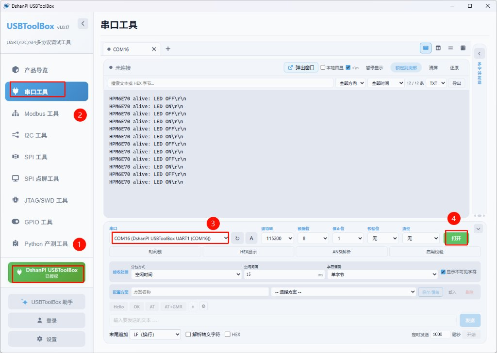

# 烧录第一个闪灯程序

这一步不需要插扩展底板，也不需要安装任何编译工具：直接用 `DshanPI USBToolBox` 给**单独一块 HPM6E70 核心板**烧录现成的闪灯固件，亲眼看到板载绿色 LED 闪烁并收到串口日志，就能确认硬件接线、供电、JTAG 烧录和串口观察四条链路全部畅通。

## 第一步：下载并解压固件

1. **确认硬件**：保持接好的 **HPM6E70 核心板 + JTAG 五线 + UART0 串口线**，确认核心板已上电、调试器已插在电脑 USB 上（无需接底板和外设模块）；
2. **下载并解压闪灯固件**：点击下载核心板闪灯固件包 [`00_blinky.zip`](https://dl.100ask.net/Hardware/MCU/HPM6E70-ZEPHYR/firmware/00_blinky.zip)，将其解压得到 **`00_blinky.hex`** 文件。

:::caution[一定要先解压再导入]
烧录工具需要导入解压出来的 `.hex` 文件，**不要直接选择 `.zip` 压缩包**。`.hex` 文件内部已携带烧录起始地址（`0x80000000`），无需手动填写地址。
:::

## 第二步：用 USBToolBox 烧录

打开 `DshanPI USBToolBox` 上位机，按图中标号 `1`～`6` 顺序完成烧录：


1. **确认设备已授权连接**：查看软件左下角显示绿色 **`DshanPI USBToolBox 已授权`**；
2. **打开 JTAG/SWD 工具**：在左侧菜单点击 **`JTAG/SWD 工具`**，顶部页签保持在 **`固件烧录`**；
3. **选择芯片平台**：下拉选择 **`HPMicro / HPM`**；
4. **选择目标配置**：下拉选择 **`HPM6E70`**，保持默认速率 `500 kHz`，勾选 **`烧录后运行`**；
5. **导入闪灯固件**：点击 **`选择文件`**，选中刚才解压出来的 **`00_blinky.hex`**；
6. **检测并开始烧录**：先点 **`检测连接`**（底部日志出现 `Examined RISC-V core`），再点击 **`开始烧录`**；等待写入并校验通过后，固件会自动复位启动。

## 第三步：观察闪灯与串口日志

烧录完成后，先看核心板 LED 闪烁，再直接在 `DshanPI USBToolBox` 中查看串口日志：

- **板载 LED 现象**：核心板绿色 LED（`PC22`）以 **1 秒间隔**周期性亮灭。
- **打开串口查看日志**：保持在 `DshanPI USBToolBox` 软件内，按图中标号 `1`～`4` 顺序操作：



1. **确认设备已授权连接**：查看软件左下角显示绿色 **`DshanPI USBToolBox 已授权`**；
2. **进入串口工具**：在左侧菜单点击 **`串口工具`**；
3. **选择端口与参数**：在底部 **串口** 下拉框选择 **`DshanPI USBToolBox UART1`** 对应的 COM 端口（图中 `COM16` 仅为示例，请以你电脑实际分配的编号为准），通信参数保持默认 **`115200 8N1`**（波特率 `115200`、数据位 `8`、停止位 `1`、校验位 `无`、流控 `无`）；
4. **打开串口并按复位**：点击右侧绿色 **`打开`** 按钮，再按一下核心板 **RESET** 键，日志区就会持续输出每秒一次的 LED 状态打印：

```text
HPM6E70 Zephyr bring-up: UART0 PA00/PA01, 115200 8N1
HPM6E70 alive: LED ON
HPM6E70 alive: LED OFF
HPM6E70 alive: LED ON
```

看到**绿灯规律闪烁**且**串口日志持续刷新**，说明你的核心板、调试器和电脑通信已全部验证通过。

## 常见问题排查

| 现象 | 可能原因 | 解决方法 |
| --- | --- | --- |
| 左下角未显示已授权或检测连接失败 | 调试器驱动异常、核心板未上电或 JTAG 线接错 | 先确认核心板已上电，再回查 [连接调试器与串口](../start-01-连接调试器与串口/README.md) 核对 JTAG 五根线 |
| 导入文件报错或无法烧录 | 直接选择了未解压的 `.zip` 压缩包 | 先解压 `00_blinky.zip`，重新选择里面的 `00_blinky.hex` |
| 打开串口提示端口被占用 | 同一 COM 口被多个串口软件同时打开 | 关闭其他正在占用该 COM 口的串口工具或终端后重试 |
| 绿灯正常闪烁但串口一片空白 | 选错了 COM 口、RX/TX 接反或分线器插反 | 确认选择了 `UART1`（而非 `RS-485 Port`），核对分线器 `RX ↔ TXD1`、`TX ↔ RXD1` 交叉接线并确认白座朝上，再按一次 **RESET** 键 |
| 串口输出乱码 | 波特率设置不是 `115200` 或 `GND` 虚接 | 核对参数为 `115200`、`8`、`1`、校验位 `无`、流控 `无`，并检查串口 `GND` 是否接牢 |

## 下一步学习路线

到这里，核心板首次点亮已经完成。你可以按当前学习目标自由选择下一步：

- **先快速体验 14 个外设模块**：无需搭建编译环境，直接进入 **[一期 · 认识实验套件](../p1-00-认识实验套件/README.md)**，下载对应外设固件用 `USBToolBox` 烧录体验。
- **进入源码修改、编译与驱动开发**：继续下一篇 **[获取源码与编译烧录](../start-04-获取源码与编译烧录/README.md)**，下载完整工程包并用命令行跑通 `west build` 与 `west flash`。

---

[上一步：安装 USBToolBox 与驱动](../start-02-安装USBToolBox与驱动/README.md) · [下一步：获取源码与编译烧录](../start-04-获取源码与编译烧录/README.md) · [直接进入一期体验](../p1-00-认识实验套件/README.md)
