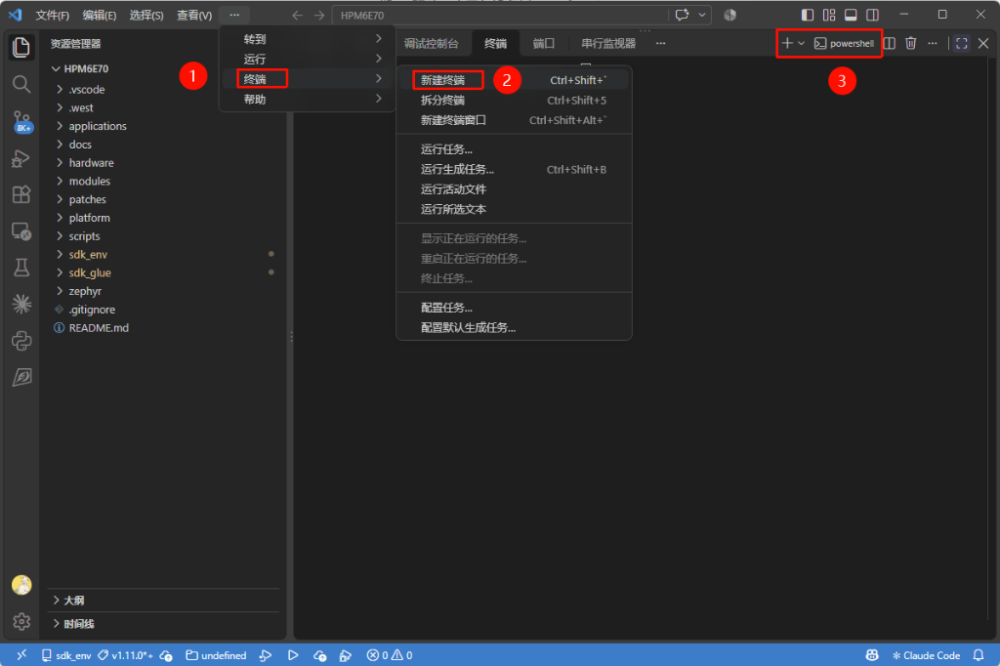
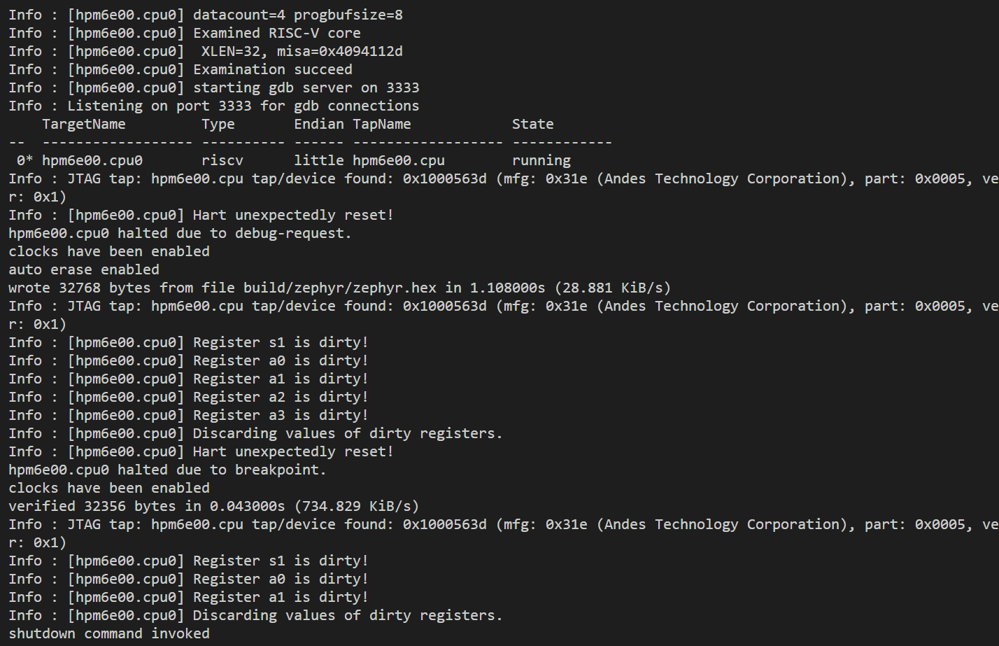
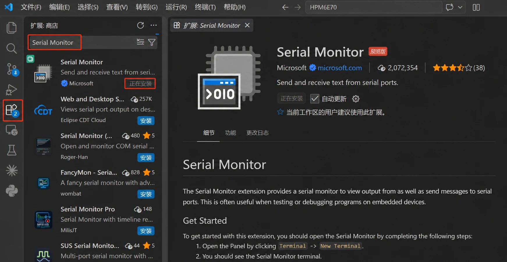
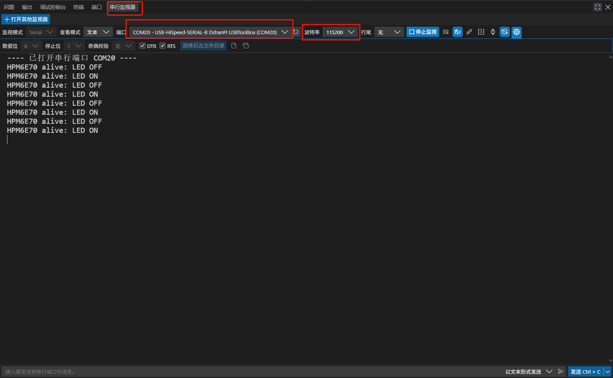

# 获取源码与编译烧录

前面通过预编译固件验证了板卡和烧录通道。接下来我们下载完整的 `HPM6E70` Zephyr 工程源码包，在本地亲手把 `blinky` 源码编译成固件并经命令行烧录到核心板，彻底跑通源码开发闭环。

**工程包已随包内置全部开发工具**（Python 3.12、CMake、Ninja、Git、RISC-V 交叉编译器、OpenOCD 和 `west`），**无需单独安装系统软件，也不用配置环境变量或激活虚拟环境**。

## 第一步：下载并解压工程包

1. 从百度网盘下载完整工程压缩包：
   - 下载地址：[HPM6E70 Zephyr 完整工程包（百度网盘）](https://pan.baidu.com/s/1MhRRBlo67EJC7R2IGM6VwA?pwd=kdqu)
   - 提取码：`kdqu`
2. 将压缩包解压到**不包含中文和空格的短路径**，例如 `D:\work\HPM6E70\`（盘符可自行选择，避免解压到桌面、中文目录或过深路径）。

解压完成后，在 `HPM6E70` 根目录可以看到以下主要文件夹：

| 目录 | 说明 |
| --- | --- |
| `.venv/` | 随包命令行启动器（`python.exe`、`west.exe`），自动关联 `sdk/` 工具链 |
| `.west/` | `west` 工作区配置，指向 `platform/west.yml` |
| `applications/` | 17 个可独立编译运行的 Zephyr 示例源码（含 `blinky`、`hpm6e70_demo` 等） |
| `platform/` | 本课程的板卡定义（Board）、设备树 Binding 与自研外设驱动 |
| `sdk/` | 内置 Python、CMake、Ninja、Git、RISC-V 工具链、OpenOCD 与驱动安装脚本 |
| `zephyr/`、`sdk_glue/`、`sdk_env/` | Zephyr v3.7.0 内核、HPMicro 适配层与 HPM SDK 源码 |

## 第二步：用 VS Code 打开工程并检测工具链

用 **VS Code** 打开解压后的 **`HPM6E70`** 工程文件夹（菜单栏 **`文件 → 打开文件夹`**），按图中标号 `1`～`3` 打开内置 **PowerShell** 终端：



1. 点击顶部菜单 **`终端`**（窗口较窄时先点菜单栏里的 **`...`**）；
2. 选择 **`新建终端`**（快捷键 ``Ctrl + Shift + ` ``）；
3. 确认终端右侧显示为 **`powershell`**（如果不是，点 `+` 旁的下拉箭头切换为 `PowerShell`）。

在终端中执行以下命令，确认工程目录和内置工具完整：

```powershell
Test-Path .\.west\config
Test-Path .\sdk\python\python.exe
Test-Path .\sdk\git\cmd\git.exe
Test-Path .\sdk\cmake\bin\cmake.exe
.\.venv\Scripts\python.exe -m west --version
```

前四行均输出 `True`，最后一行输出 `West version: v1.5.0` 即表示环境就绪。

:::note[为什么统一使用 `.\.venv\Scripts\python.exe`？]
`.venv\Scripts` 里放的是按自身位置自动寻找 `sdk/` 工具链的原生启动器，**不是普通 Python 虚拟环境，不需要执行激活脚本**。只要始终用 `.\.venv\Scripts\python.exe -m west ...` 作为入口，工程拷到任意磁盘或新电脑都能直接编译，且不会被电脑上已有的系统 Python 或旧工具干扰。
:::

## 第三步：编译闪灯工程

以核心板闪灯示例 `applications\blinky` 为例，在 VS Code 的 PowerShell 终端中执行：

```powershell
.\.venv\Scripts\python.exe -m west build -b dshanmcu_hpm6e70 applications\blinky -d build\blinky
```

| 参数 | 作用 |
| --- | --- |
| `-b dshanmcu_hpm6e70` | 指定目标板卡（来自 `platform/boards/` 下的 Board 定义） |
| `applications\blinky` | 要编译的应用源码目录 |
| `-d build\blinky` | 独立构建输出目录，避免多个应用互相覆盖缓存 |

首次编译会完整构建 Zephyr 内核与驱动，通常耗时数十秒到数分钟；之后修改 `src/main.c` 属于增量编译，几秒即可完成。终端最后输出内存占用统计并生成固件文件即表示编译成功：

- `build\blinky\zephyr\zephyr.elf`（带调试符号的完整镜像）
- `build\blinky\zephyr\zephyr.hex`（Intel HEX 烧录镜像）
- `build\blinky\zephyr\zephyr.bin`（原始二进制镜像）

> 提示：如果后续修改了 `prj.conf` 或 `.overlay` 设备树文件，请在 `west build` 后加上 `-p always` 强制重新配置构建。

## 第四步：烧录并验证运行

:::caution[命令行烧录前先关闭 USBToolBox 上位机]
`DshanPI USBToolBox` 软件与命令行 `west flash`（底层调用随包 OpenOCD）共用同一个 JTAG 烧录接口。运行 `west flash` 之前请先**退出 USBToolBox 上位机**（或断开其 JTAG 连接），否则会提示设备被占用。
:::

确认核心板已上电、JTAG 五线接好，在工程根目录执行：

```powershell
.\.venv\Scripts\python.exe -m west flash -d build\blinky
```

`west flash` 会自动检查是否需要增量编译，随后调用随包 OpenOCD 经 JTAG 写入板载 NOR Flash 并完成回读校验与芯片复位。看到类似 `wrote ... bytes`、`verified ... bytes` 以及 `shutdown command invoked` 即表示烧录成功：



此时板载绿色 LED（`PC22`）应恢复每秒闪烁一次。查看串口日志可以任选下面两种方式之一（参数统一为 **`DshanPI USBToolBox UART1`** 对应 COM 口、**`115200 8N1`**）：

### 方式一：使用 VS Code `Serial Monitor`

直接在 VS Code 底部面板查看串口日志，改完代码执行 `west build` / `west flash` 时不用来回切换窗口：

1. 在 VS Code 扩展市场搜索 **`ms-vscode.vscode-serial-monitor`**，认准发布者 **Microsoft** 并安装：



2. 打开 VS Code 底部 **`Serial Monitor`** 面板，端口选择 **`DshanPI USBToolBox UART1`** 对应的 COM 口，波特率选择 **`115200`**（数据位 `8`、停止位 `1`、无校验、无流控），点击 **`Start Monitoring`** 后按一下核心板 **RESET** 键，即可看到你亲手编译出来的程序打印：

```text
HPM6E70 Zephyr bring-up: UART0 PA00/PA01, 115200 8N1
HPM6E70 alive: LED ON
HPM6E70 alive: LED OFF
```



### 方式二：使用 `DshanPI USBToolBox` 自带串口工具

如果不想在 VS Code 中安装扩展，也可以沿用上一篇的方法：打开 `DshanPI USBToolBox`，进入左侧 **`串口工具`**，选择 **`DshanPI USBToolBox UART1`** 对应 COM 口并保持 **`115200 8N1`** 点击 **`打开`** 即可（完整图文步骤见 [烧录第一个闪灯程序](../start-03-烧录第一个闪灯程序/README.md)）。

> 提示：如果使用 `USBToolBox` 查看串口，下次需要命令行运行 `west flash` 之前，记得先关闭 `USBToolBox` 上位机以免占用 JTAG 调试接口。

如果想顺便尝试修改源码体验重新编译：打开 `applications\blinky\src\main.c`，把 `k_sleep(K_SECONDS(1));` 改成 `k_sleep(K_MSEC(200));`，再重新运行上面的 `west build` 和 `west flash`，就能立刻看到板载绿灯变成快闪。

## 常见问题排查

| 现象 | 可能原因 | 解决方法 |
| --- | --- | --- |
| 报错找不到 `west` 或工具链 | 直接敲了系统 `west` / `python` | 改为使用 `.\.venv\Scripts\python.exe -m west ...` |
| 编译时报编码或路径异常 | 工程解压路径包含中文字符或空格 | 将整个 `HPM6E70` 文件夹移动到纯英文短路径（如 `D:\work\HPM6E70`）后加 `-p always` 重建 |
| `west flash` 报错无法打开 JTAG 设备 | `USBToolBox` 上位机仍占着 JTAG，或驱动未装好 | 关闭 `USBToolBox` 上位机重试；如仍报错，管理员运行 `.\sdk\driver\Install-DshanPI-USBToolBox.cmd` |
| 改完 `prj.conf` 或设备树后效果没变 | 增量构建沿用了旧配置缓存 | 在 `west build` 命令中加入 `-p always` 重新生成配置 |

## 进入正式课程

到这里，硬件接线、工具驱动、图形化烧录与源码编译烧录四步准备已全部打通。你可以按需进入对应阶段：

- **[一期 · 外设模块快速体验](../p1-00-认识实验套件/README.md)**：结合底板与 14 个外设模块快速体验现象；
- **[二期 · 驱动、应用与设备树](../p2-01-从example-application认识标准工程/README.md)**：系统学习 Zephyr 工程模型、设备树、驱动开发与 14 个 Demo 源码详解；
- **[三期 · 从零搭建完整工程](../p3-01-搭建SDK-Glue工作区/README.md)**：从空目录搭建工作区并亲手完成 SoC、Board、Flash 与 SDRAM 移植。

---

[上一步：烧录第一个闪灯程序](../start-03-烧录第一个闪灯程序/README.md) · [进入一期](../p1-00-认识实验套件/README.md) · [进入二期](../p2-01-从example-application认识标准工程/README.md) · [课程目录](../README.md)
