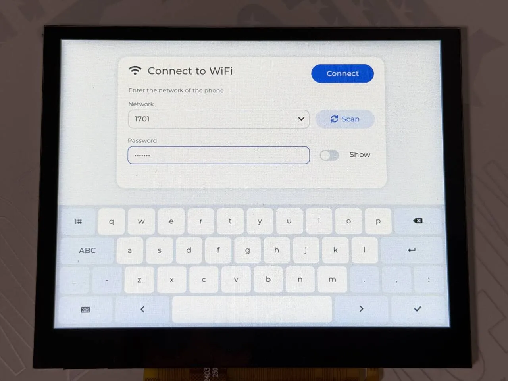
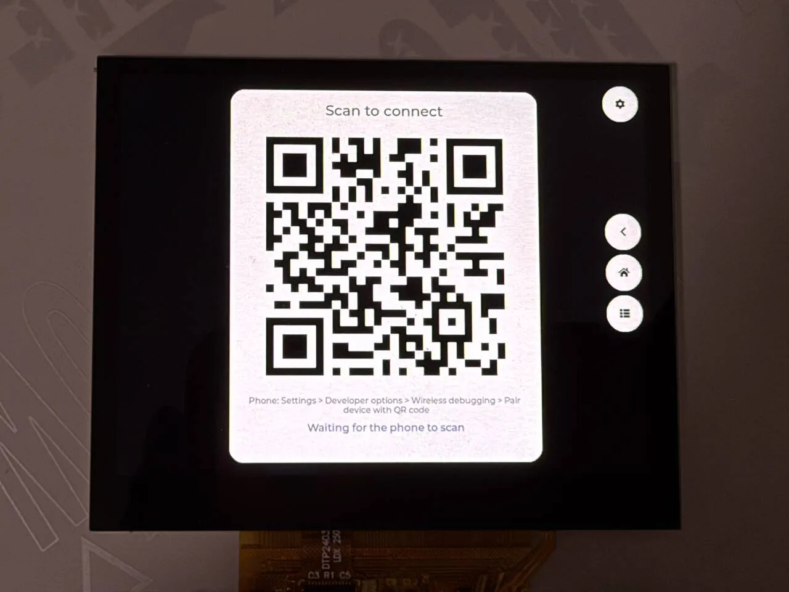
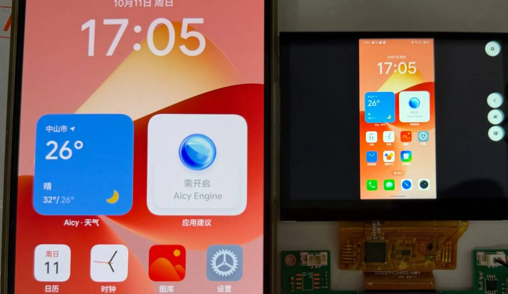
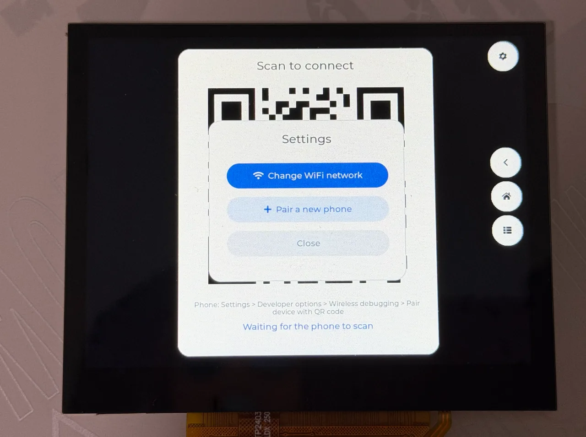

import YuzukiBoardStage from '@site/src/components/YuzukiNekoHome/YuzukiBoardStage';
import FirmwareDownloadCard from '@site/src/components/FirmwareDownloadCard';
import SourceRefBar from '@site/src/components/SourceRefBar';

# 安卓无线投屏

通过 Wi-Fi 将安卓手机屏幕实时镜像到 YuzukiCube-M 的 1024×768 彩屏，并支持在开发板触摸屏上直接滑动、点击回控手机。

<SourceRefBar sourcePath="zephyr-components/android-screen-mirror/samples/mirror_player" to="/docs/yuzukineko/dev/zephyr/apps/android-mirror" />

## 第一步：准备硬件连接

<YuzukiBoardStage defaultBoard="base" isHero={false} focusNodes={['dsi', 'wifi', 'slot']} />

1. 确认 YuzukiNeko 已安装在 YuzukiCube-M 底板上，并扣紧以下连线：
   - **显示与触摸排线**：40 脚排线稳妥接入底板 `FPC1`；
   - **Wi-Fi 天线**：将 IPEX 天线扣在底板 `RF1` 天线座上（不接天线信号极弱，容易连不上或断流）。
2. 将串口分线器按正确正反方向插到 YuzukiNeko 的 USB-C 口，并接入电脑（兼顾烧录、5 V 供电与串口日志观察）。

## 第二步：格式化并配置 TF 卡

1. 将一张 TF 卡通过读卡器插入电脑，格式化为 **FAT32**（或 exFAT）。
2. 点击直链下载配套的 v5.0.1 服务端文件 [`scrcpy-server-v5.0.1`](https://github.com/Genymobile/scrcpy/releases/download/v5.0.1/scrcpy-server-v5.0.1)（来源：[scrcpy v5.0.1 发布页](https://github.com/Genymobile/scrcpy/releases/tag/v5.0.1)）。
3. 将下载好的文件重命名为 **`scrcpy-server.jar`**，复制到 TF 卡**根目录**。
4. *(可选)* 如果不想开机后在屏幕上手动输入 Wi-Fi 密码，可在 TF 卡根目录新建纯文本文件 **`wifi.cfg`**（注意在 Windows 中确认没有隐藏的 `.txt` 后缀），只写两行（第一行 2.4 GHz Wi-Fi 名称，第二行密码）：

```text
你的2.4G_WiFi名称
你的WiFi密码
```

<figure style={{ maxWidth: '480px', margin: '0.75rem auto 1.1rem', border: '1px solid var(--ifm-color-emphasis-200)', borderRadius: '10px', overflow: 'hidden', background: 'var(--ifm-background-surface-color)' }}>
  
  <figcaption style={{ padding: '0.5rem 0.75rem', fontSize: '0.82rem', color: 'var(--ifm-color-emphasis-700)', lineHeight: 1.45, textAlign: 'center' }}>
    wifi.cfg 实拍示例：第一行填 Wi-Fi 名称，第二行填密码（无引号、无多余空行）
  </figcaption>
</figure>

5. 核对 TF 卡根目录结构（卡内可同时存放其他体验文件，确认红框处的 `scrcpy-server.jar` 和 `wifi.cfg` 均位于根目录即可）：

```text
TF 卡根目录/
├── scrcpy-server.jar    # 必放，由 scrcpy-server-v5.0.1 重命名而来
└── wifi.cfg             # 可选，不放时开机在屏幕上配置后会自动生成
```

<figure style={{ maxWidth: '731px', margin: '0.75rem auto 1.2rem', border: '1px solid var(--ifm-color-emphasis-200)', borderRadius: '10px', overflow: 'hidden', background: 'var(--ifm-background-surface-color)' }}>
  
  <figcaption style={{ padding: '0.5rem 0.75rem', fontSize: '0.82rem', color: 'var(--ifm-color-emphasis-700)', lineHeight: 1.45, textAlign: 'center' }}>
    TF 卡根目录示例：确认红框内的 scrcpy-server.jar（约 717 KB）与 wifi.cfg 放在根目录，且没有隐藏的 .txt 后缀
  </figcaption>
</figure>

6. 安全弹出读卡器，将 TF 卡插入 YuzukiNeko 正面右侧的 TF 卡槽。

## 第三步：下载并烧录固件

<FirmwareDownloadCard filename="01_android_mirror-full.img" size="4.79 MiB" />

下载完成后，打开 **LYNX Imager**（全志 F101 → SPI NOR → 勾选主线 · SPI NOR），按住开发板正面 FEL 键重新上电后导入该镜像写入并等待自动重启。完整图文向导见 [烧录第一个体验固件](../start/02-flash-first-firmware.md)。

## 第四步：在安卓手机上打开无线调试

要求安卓 11 及以上手机，且手机与开发板连接在**同一个 2.4 GHz Wi-Fi 路由器**下（不要连访客网络，路由器勿开启 AP/客户端隔离）：

1. 进入手机 **设置 → 关于手机**，连续点击「版本号」7 次开启开发者模式。
2. 返回进入 **设置 → 开发者选项**，打开 **USB 调试** 和 **无线调试**。
3. 小米 / 红米等部分机型需同时打开 **USB 调试（安全设置）**，否则只能看到投屏画面，手指触摸无法回控手机。

## 第五步：开机配网、扫码配对与投屏测试

1. **连接 Wi-Fi**：如果 TF 卡里没有提前放 `wifi.cfg`，开机后屏幕自动显示 Wi-Fi 表单。点击 **Scan** 扫描并选择你的 2.4 GHz Wi-Fi，用屏幕键盘输入密码后点击连接（连接成功后自动保存到 TF 卡 `/SD:/wifi.cfg`，下次开机免重输）：



2. **手机扫码配对**：连上 Wi-Fi 后，屏幕中央自动弹出配对二维码（右侧为三个安卓虚拟导航键，右上角为设置按钮）：



   在手机端进入 **开发者选项 → 无线调试 → 使用二维码配对设备**，对准开发板屏幕扫码完成配对（首次配对后私钥自动保存在 `/SD:/adbkey`）。

3. **实测投屏与触摸回控**：配对成功后等待几秒，开发板会自动把 `scrcpy-server.jar` 推送到手机并拉起实时画面。此时滑动屏幕、打开 App、点击右侧导航键即可验证流畅度与触摸回控：



4. **更换网络或换绑新手机**：需要切换 Wi-Fi 或重新配对另一部手机时，点击屏幕右上角的设置图标即可：



## 常见问题排查

| 现象 | 可能原因 | 解决方法 |
| --- | --- | --- |
| 扫码配对成功后无法出画面或反复重连 | TF 卡未放 `scrcpy-server.jar`，或误下载了旧版（如 3.3.1） | 确认 TF 卡根目录是 `v5.0.1` 重命名的 `scrcpy-server.jar`，且无隐藏后缀 |
| 能看到手机画面但触摸点不动 | 手机系统拦截了模拟点击注入 | 在手机开发者选项中开启「USB 调试（安全设置）」后重连 |
| 一直停在二维码界面扫不上或找不到服务 | 手机和板子不在同一局域网，或路由器屏蔽 mDNS 组播 | 确认同连 2.4 GHz 主网并关闭 AP 隔离；关闭再重开手机「无线调试」重试 |

---

[应用总览](overview.md) · [下一项：Miracast 无线显示](02-miracast.md)
