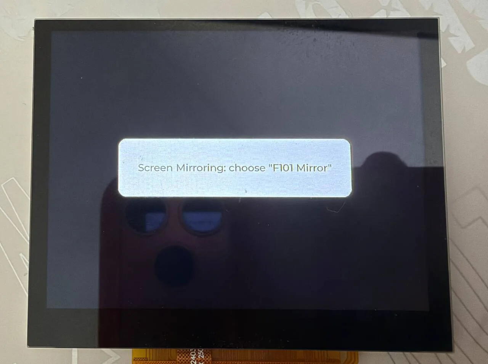
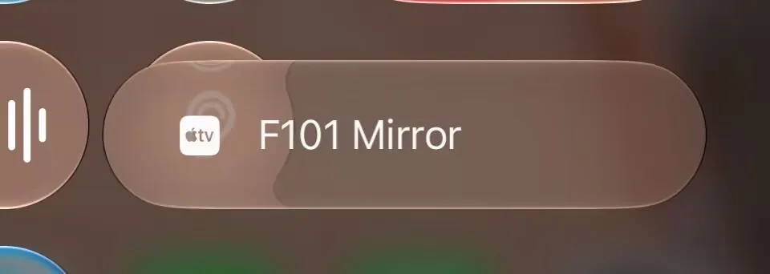
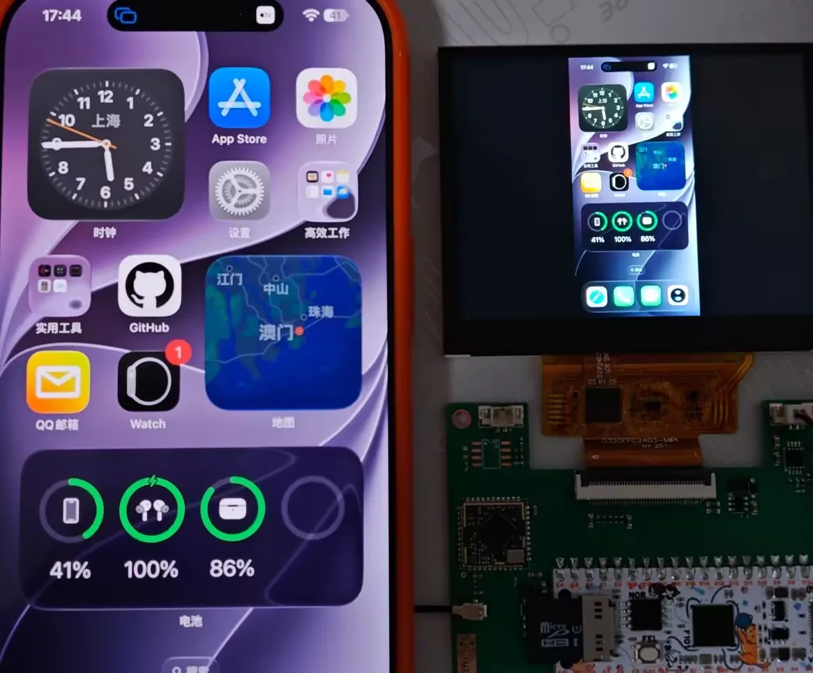

import YuzukiBoardStage from '@site/src/components/YuzukiNekoHome/YuzukiBoardStage';
import FirmwareDownloadCard from '@site/src/components/FirmwareDownloadCard';
import SourceRefBar from '@site/src/components/SourceRefBar';

# iOS 投屏 (AirPlay)

让开发板以 AirPlay 接收端身份出现在 iPhone / iPad 的「控制中心 → 屏幕镜像」列表中，支持 960×720 流畅投屏以及竖屏/横屏反复切换居中显示（当前仅镜像画面，不含音频）。

<SourceRefBar sourcePath="zephyr-components/ios-screen-mirror/samples/ios_player" to="/docs/yuzukineko/dev/zephyr/apps/ios-mirror" />

## 第一步：准备硬件连接

<YuzukiBoardStage defaultBoard="base" isHero={false} focusNodes={['dsi', 'wifi', 'slot']} />

1. 确认 YuzukiNeko 已装在 YuzukiCube-M 底板上，扣紧 `FPC1` 40 脚屏排线和 `RF1` IPEX Wi-Fi 天线。
2. 通过 USB-C 串口分线器连接电脑，方便烧录与查看串口入网状态。

## 第二步：格式化并配置 TF 卡（必做）

本固件启动时会从 TF 卡读取 Wi-Fi 凭据，必须提前在卡上准备好 `wifi.cfg`：

1. 将 TF 卡通过读卡器插入电脑，格式化为 **FAT32**（或 exFAT）。
2. 在 TF 卡**根目录**新建纯文本文件 **`wifi.cfg`**（用记事本或 VS Code 保存时确认文件名没有变成 `wifi.cfg.txt`），严格只写两行：**第一行是 2.4 GHz Wi-Fi 名称，第二行是密码**（不要加引号、不要留多余空行；若是开放网络则第二行留空）：

```text
MyHomeWiFi
my-password-123
```

<figure style={{ maxWidth: '480px', margin: '0.75rem auto 1.1rem', border: '1px solid var(--ifm-color-emphasis-200)', borderRadius: '10px', overflow: 'hidden', background: 'var(--ifm-background-surface-color)' }}>
  
  <figcaption style={{ padding: '0.5rem 0.75rem', fontSize: '0.82rem', color: 'var(--ifm-color-emphasis-700)', lineHeight: 1.45, textAlign: 'center' }}>
    wifi.cfg 实拍示例：第一行填 Wi-Fi 名称，第二行填密码（无引号、无多余空行）
  </figcaption>
</figure>

3. 核对 TF 卡根目录结构：

```text
TF 卡根目录/
└── wifi.cfg    # 必放，两行纯文本（第 1 行 SSID，第 2 行密码）
```

4. 安全弹出读卡器，将 TF 卡插入 YuzukiNeko 正面右侧的 TF 卡槽。

## 第三步：下载并烧录固件

<FirmwareDownloadCard filename="03_ios_mirror-full.img" size="4.76 MiB" />

下载完成后，打开 **LYNX Imager**（全志 F101 → SPI NOR → 勾选主线 · SPI NOR），按住开发板正面 FEL 键重新上电后导入该镜像写入并等待自动重启。完整图文向导见 [烧录第一个体验固件](../start/02-flash-first-firmware.md)。

## 第四步：上电入网与 iPhone 屏幕镜像测试

1. **确认开发板连上 Wi-Fi 并广播 AirPlay**：
   - 开机后屏幕先显示 `Joining the WiFi`，串口（115200 8N1）依次打印 AIC8800 初始化、连接路由器与获取 IP 地址；
   - 连网成功后屏幕卡片切换为 `Screen Mirroring: choose "F101 Mirror"`：



2. **在 iPhone / iPad 发起屏幕镜像**：
   - 确保 iPhone 与开发板连在**同一个 Wi-Fi 路由器**下（勿连访客网络或开 AP 隔离）；
   - 从 iPhone 屏幕右上角下拉打开控制中心，点击 **屏幕镜像**，在列表中选择 **`F101 Mirror`**：



3. **实测竖屏与横屏切换**：
   - 等待数秒后 iPhone 画面即同步到开发板彩屏；
   - 试着打开相册或视频 App 将手机横放再竖回，观察开发板画面自动居中裁剪与稳定恢复：



## 常见问题排查

| 现象 | 可能原因 | 解决方法 |
| --- | --- | --- |
| 屏幕提示 `No WiFi: put wifi.cfg on the card` | TF 卡未插牢、文件名多了 `.txt` 后缀或放在子目录 | 确认 TF 卡根目录文件名精确为 `wifi.cfg` 后重新插卡重启 |
| 一直卡在 `Joining the WiFi` | `wifi.cfg` 密码写错，或路由器仅启用了 WPA3 | 核对两行文本无多余空格与引号，将路由器安全模式设为 WPA2-PSK（2.4 GHz） |
| 控制中心搜不到 `F101 Mirror` | 手机和板子不在同一二层网段，或路由器拦截 mDNS | 确认同连同一主路由并关闭客户端隔离；重启路由器或重新开关手机 Wi-Fi |

---

[上一项：Miracast 无线显示](02-miracast.md) · [下一项：USB 电脑扩展副屏](04-usb-display.md) · [应用总览](overview.md)
