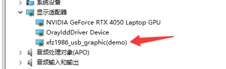
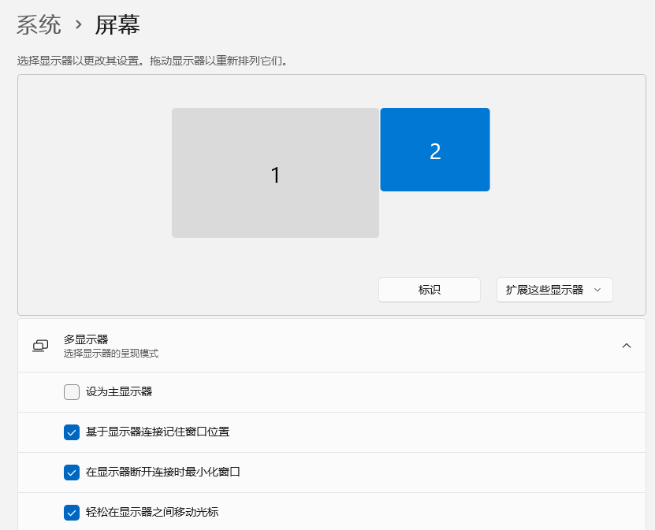
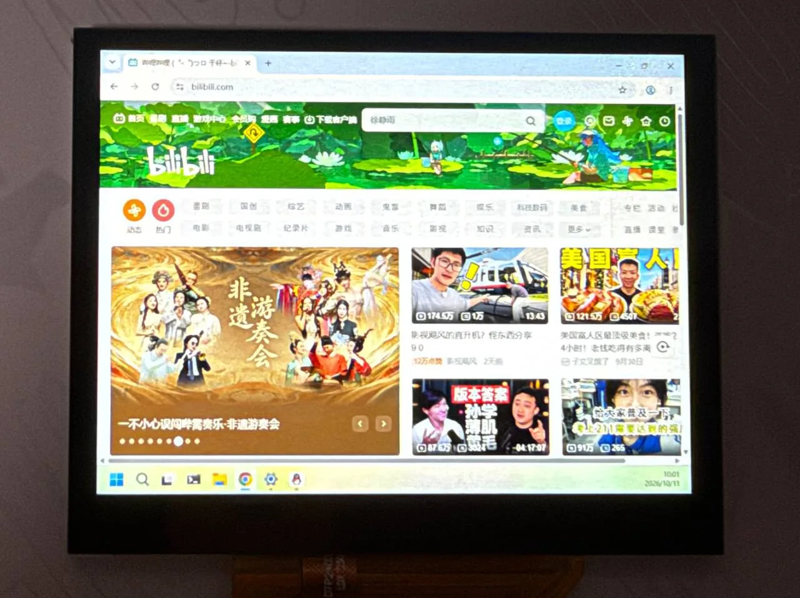

import YuzukiBoardStage from '@site/src/components/YuzukiNekoHome/YuzukiBoardStage';
import FirmwareDownloadCard from '@site/src/components/FirmwareDownloadCard';
import SourceRefBar from '@site/src/components/SourceRefBar';

# USB 电脑扩展副屏

**需先在 Windows 电脑安装虚拟显示驱动**，随后用一根 USB-C 数据线将开发板接到电脑，即可把 1024×768 彩屏变成一块桌面扩展显示器，并支持多点触控反控电脑。**不需要 TF 卡，不需要 Wi-Fi**。

<SourceRefBar sourcePath="zephyr/samples/drivers/usb/cherryusb_display" to="/docs/yuzukineko/dev/zephyr/apps/usb-display" />

## 第一步：准备硬件连接

<YuzukiBoardStage defaultBoard="base" isHero={false} focusNodes={['dsi', 'slot']} />

1. 确认 YuzukiNeko 已装在 YuzukiCube-M 底板上，并扣紧 `FPC1` 40 脚屏排线。
2. 准备一根支持数据传输的 USB-C 线（可经串口分线器直连电脑，兼顾烧录、副屏传输与串口日志观察）。

## 第二步：在 Windows 安装虚拟显示驱动（必装）

开发板对外枚举为厂商自定义 USB 显示设备，Windows 自带驱动无法识别，**必须先安装以下已签名的虚拟显示驱动**：

<FirmwareDownloadCard
  filename="xfz1986_usb_graphic_250224_rc_sign.exe"
  size="2.22 MiB"
  href="https://github.com/cherry-embedded/CherryUSB/raw/master/tools/display/xfz1986_usb_graphic_250224_rc_sign.exe"
  label="下载 Windows 驱动"
  meta="已签名 USB 虚拟显示驱动 · Windows 10 / 11"
/>

1. 点击上方按钮下载安装程序（开源出处：[win10_idd_xfz1986_usb_graphic_driver_display](https://github.com/chuanjinpang/win10_idd_xfz1986_usb_graphic_driver_display)）；
2. 双击 `xfz1986_usb_graphic_250224_rc_sign.exe`，按系统提示允许管理员权限并依默认向导完成安装（触摸接口使用 Windows 自带 HID 驱动，无需另装）。

## 第三步：下载并烧录固件

<FirmwareDownloadCard filename="04_usb_display-full.img" size="2.16 MiB" />

下载完成后，打开 **LYNX Imager**（全志 F101 → SPI NOR → 勾选主线 · SPI NOR），按住开发板正面 FEL 键重新上电后导入该镜像写入并等待自动重启。完整图文向导见 [烧录第一个体验固件](../start/02-flash-first-firmware.md)。

## 第四步：在 Windows 中验证枚举与配置扩展屏

1. **保持 USB-C 线不断开，检查设备管理器**：
   - 烧录重启后，同一根 USB-C 线会自动枚举出 USB 显示 + HID 触摸组合设备；
   - 打开 Windows **设备管理器 → 显示适配器**，确认已出现 `xfz1986_usb_graphic(demo)`（无黄色感叹号）：

2. **设置扩展显示器布局**：
   - 打开 Windows **设置 → 系统 → 屏幕**，可以看到多出一块标号 `2` 的 1024×768 显示器；
   - 将多显示器模式选为 **扩展这些显示器**，并按实际桌面摆放拖拽两块屏幕的相对位置：

3. **拖入窗口并测试触控**：
   - 将浏览器、终端或性能监控窗口拖入 2 号副屏，观察开发板屏幕实时流畅显示桌面内容；
   - 直接用手指在开发板屏幕上点击、拖动窗口验证触控响应（如触摸点落到主显示器上，见下方排查）：

   串口终端（115200 8N1）会定时输出帧率、USB 吞吐带宽与解码耗时统计。

## 常见问题排查

| 现象 | 可能原因 | 解决方法 |
| --- | --- | --- |
| 设备管理器里 `cherryusb_R1024x768...` 带感叹号 | 未安装 Windows 虚拟屏驱动 | 安装 `xfz1986_usb_graphic_250224_rc_sign.exe` 后重新插拔 USB-C 线 |
| 电脑无任何新硬件提示 | 使用了纯充电线，或开发板仍停留在 FEL 模式 | 换用带数据功能的 USB-C 线，重新拔插确保板子正常启动 |
| 手指点副屏但光标动在电脑主屏上 | Windows 触摸输入尚未绑定到副屏 | 打开 Windows「控制面板 → 平板电脑设置 → 配置触摸输入」，按屏幕提示轻点开发板屏幕完成映射 |

---

[上一项：iOS 投屏 (AirPlay)](03-ios-mirror.md) · [下一项：NekoBox 综合媒体盒](05-nekobox.md) · [应用总览](overview.md)
