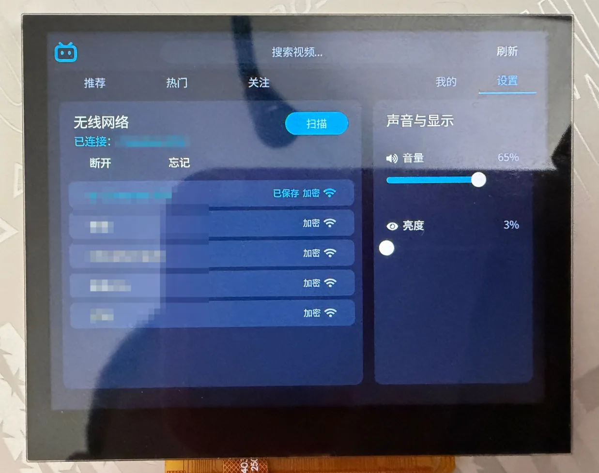
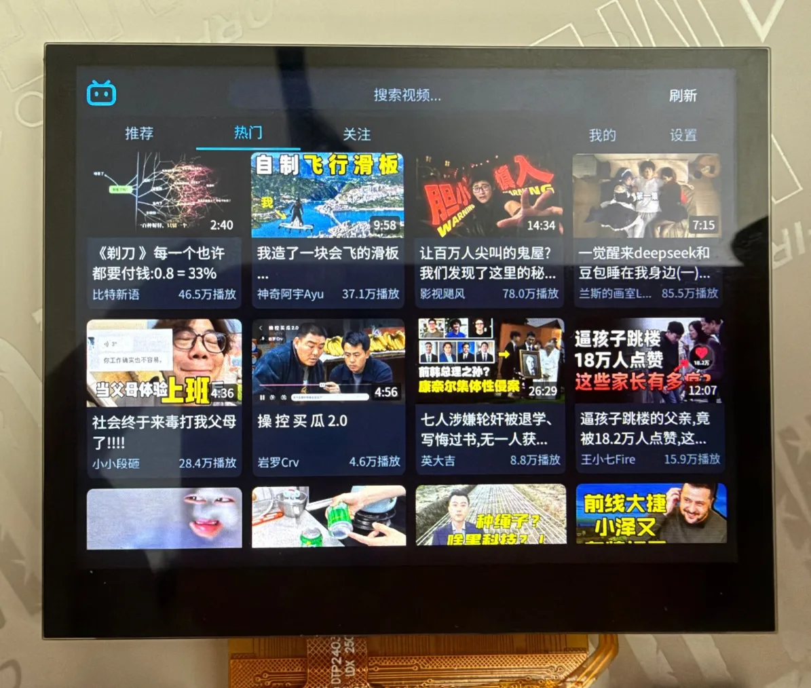
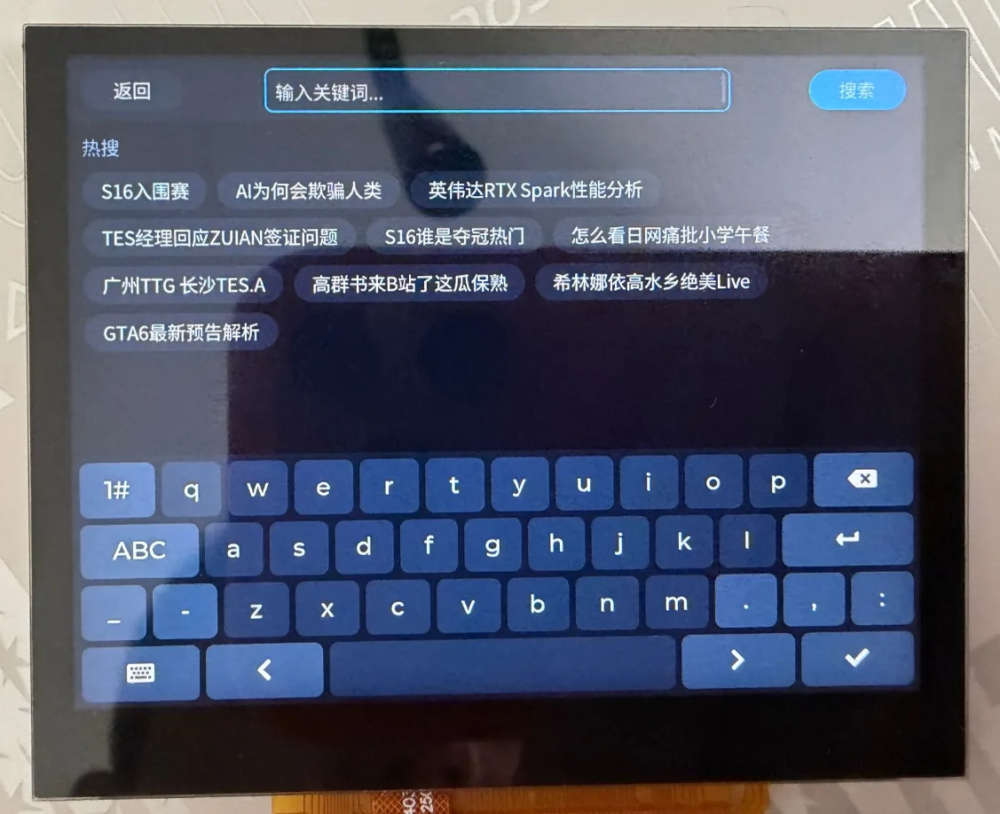
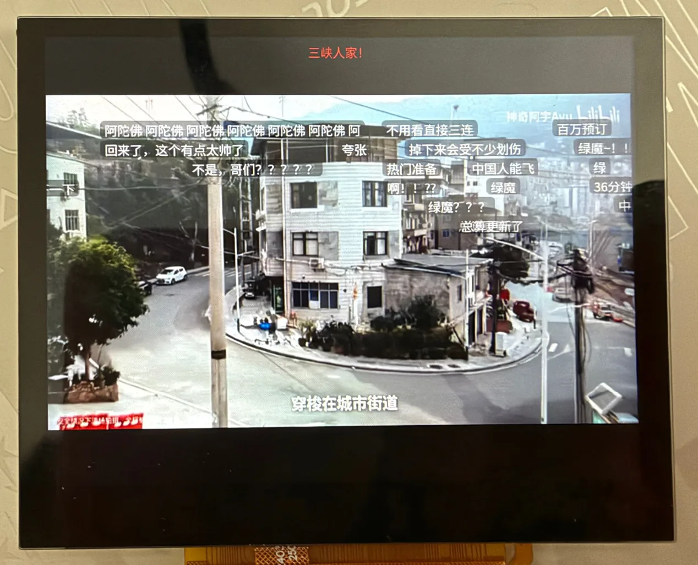
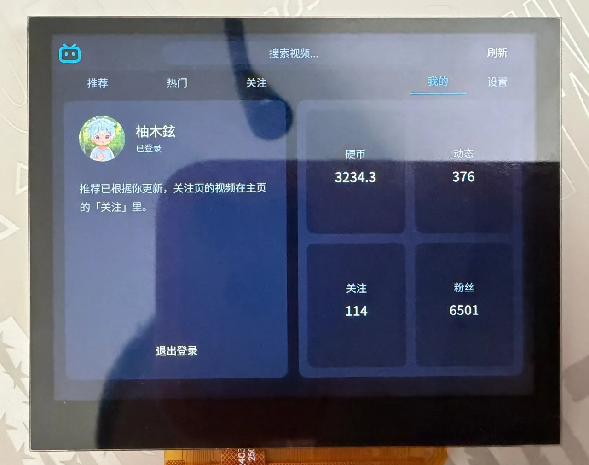

import YuzukiBoardStage from '@site/src/components/YuzukiNekoHome/YuzukiBoardStage';
import FirmwareDownloadCard from '@site/src/components/FirmwareDownloadCard';
import SourceRefBar from '@site/src/components/SourceRefBar';

# Bilibili 在线视频

在 1024×768 触摸屏上直接刷 B 站热门、拼音搜索视频、扫码登录个人账号，通过 H.264 硬解 + AAC 伴音边下边播，并叠加流畅的彩色滚动弹幕。

<SourceRefBar sourcePath="zephyr-components/bilibili-tv" to="/docs/yuzukineko/dev/zephyr/apps/bilibili" />

## 第一步：准备硬件连接

<YuzukiBoardStage defaultBoard="base" isHero={false} focusNodes={['dsi', 'wifi', 'amp', 'slot']} />

1. 确认 YuzukiNeko 已装在 YuzukiCube-M 底板上，并接齐外设：
   - **显示与触摸**：40 脚排线扣紧在 `FPC1`；
   - **Wi-Fi 天线**：IPEX 天线扣紧在 `RF1`（必接）；
   - **扬声器**：2 脚扬声器插在 `CN3`（播放视频伴音）。
2. 通过 USB-C 线（或经串口分线器）给开发板供电。

## 第二步：格式化并插入 TF 卡（必做）

本应用采用「边下载到 TF 卡、边硬解播放」机制，**必须插入有足够剩余空间的 TF 卡**：

1. 将 TF 卡格式化为 **FAT32**（或 exFAT），建议预留至少 500 MB 以上可用空间，用于存放 `/SD:/bilibili/` 缓存视频与设置文件。
2. *(可选)* 如果想开机自动连网，可在 TF 卡根目录新建两行纯文本 **`wifi.cfg`**（第 1 行 2.4 GHz Wi-Fi 名称，第 2 行密码，无 `.txt` 后缀）；不放也可以开机直接在「设置」页触屏配网：

<figure style={{ maxWidth: '480px', margin: '0.75rem auto 1.1rem', border: '1px solid var(--ifm-color-emphasis-200)', borderRadius: '10px', overflow: 'hidden', background: 'var(--ifm-background-surface-color)' }}>
  
  <figcaption style={{ padding: '0.5rem 0.75rem', fontSize: '0.82rem', color: 'var(--ifm-color-emphasis-700)', lineHeight: 1.45, textAlign: 'center' }}>
    wifi.cfg 实拍示例：第一行填 Wi-Fi 名称，第二行填密码（无引号、无多余空行）
  </figcaption>
</figure>
3. 安全弹出读卡器，插入 YuzukiNeko 正面右侧卡槽。

## 第三步：下载并烧录固件

<FirmwareDownloadCard filename="06_bilibili-full.img" size="6.20 MiB" />

下载完成后，打开 **LYNX Imager**（全志 F101 → SPI NOR → 勾选主线 · SPI NOR），按住开发板正面 FEL 键重新上电后导入该镜像写入并等待自动重启。完整图文向导见 [烧录第一个体验固件](../start/02-flash-first-firmware.md)。

## 第四步：触屏配网与在线视频实测

1. **连接 Wi-Fi 并调好音量**：
   - 未放 `wifi.cfg` 时，开机后先点击左侧导航栏 **设置**，扫描并连接可上外网的 2.4 GHz WPA2-PSK Wi-Fi，同时可在此页调节播放音量与屏幕亮度（设置会自动保存到 TF 卡）：

2. **浏览热门与拼音搜索**：
   - 切回 **首页**，等待热门视频封面卡片加载完成后即可上下滑动浏览；
   - 切到 **搜索** 页，使用内置屏幕拼音键盘输入关键词或点击热搜词检索视频：

3. **点播视频与观察弹幕**：
   - 点击任意视频卡片进入播放页，等待短暂缓冲后即可看到 H.264 硬解画面与彩色滚动弹幕，`CN3` 扬声器同步出声（已完整下载到 `/SD:/bilibili/<BV号>.mp4` 的视频下次点开直接本地秒播）：

4. **扫码登录账号（可选）**：
   - 不登录即可体验热门与搜索；若想解锁更高清晰度，进入 **我的** 页用手机 B 站客户端扫描二维码登录即可：

## 常见问题排查

| 现象 | 可能原因 | 解决方法 |
| --- | --- | --- |
| 点开视频提示失败或一直无法缓冲 | 未插 TF 卡或 TF 卡已满/未格式化为 FAT32/exFAT | 确认已插紧剩余空间充足的 FAT32/exFAT TF 卡后重启 |
| 首页一直空白加载不出封面 | Wi-Fi 未连接成功或当前网络无法访问外网 | 进入「设置」页确认已获取到 IP 地址，且路由器使用 2.4 GHz WPA2-PSK |
| 有画面无伴音 | `CN3` 扬声器未插紧或设置页音量过低 | 检查底板 `CN3` 扬声器线，并在设置页拉高音量滑条 |

---

[上一项：NekoBox 综合媒体盒](05-nekobox.md) · [下一项：MP4 本地播放器](07-mp4-player.md) · [应用总览](overview.md)
