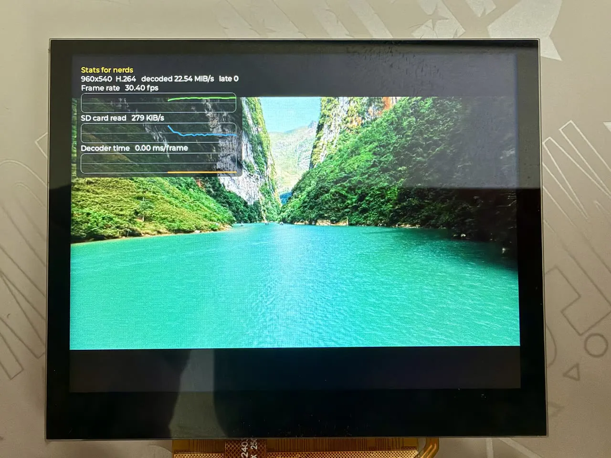

import YuzukiBoardStage from '@site/src/components/YuzukiNekoHome/YuzukiBoardStage';
import FirmwareDownloadCard from '@site/src/components/FirmwareDownloadCard';
import SourceRefBar from '@site/src/components/SourceRefBar';

# MP4 本地播放器

上电后自动从 TF 卡读取本地 MP4 视频，利用片上视频引擎进行 H.264 硬件解码并同步输出 AAC 伴音，播完后自动无缝循环播放。

<SourceRefBar sourcePath="zephyr/samples/drivers/mp4_player" to="/docs/yuzukineko/dev/zephyr/apps/mp4-player" />

## 第一步：准备硬件连接

<YuzukiBoardStage defaultBoard="base" isHero={false} focusNodes={['dsi', 'amp', 'slot']} />

1. 确认 YuzukiNeko 已装在 YuzukiCube-M 底板上，扣紧 `FPC1` 40 脚屏排线，并将 2 脚扬声器插到底板 `CN3`（收听伴音）。
2. 通过 USB-C 线（或经串口分线器）连接电脑，方便烧录与查看串口日志。

## 第二步：转码并配置 TF 卡（必做）

本固件启动时固定读取 TF 卡根目录下的 **`video540p.mp4`**，对视频编码规格有明确要求：

| 项目 | 要求 |
| --- | --- |
| 文件路径与命名 | TF 卡根目录 **`video540p.mp4`**（严格区分文件名） |
| 视频轨道 | H.264（8-bit `yuv420p`，建议 960×540 或 720p 以内、30 fps） |
| 音频轨道 | AAC-LC，采样率 **44100 Hz** 或 **48000 Hz**，双声道 |

1. **在电脑上用 `ffmpeg` 转出标准测试文件**（把 `input.mp4` 换成你手头的任意视频）：

```sh
ffmpeg -i input.mp4 \
  -vf "scale=960:540:force_original_aspect_ratio=decrease,pad=960:540:(ow-iw)/2:(oh-ih)/2" \
  -c:v libx264 -profile:v main -pix_fmt yuv420p -r 30 \
  -c:a aac -ar 44100 -ac 2 -b:a 128k \
  -movflags +faststart video540p.mp4
```

   *(可选)* 用 `ffprobe` 核对编码参数无误：

```sh
ffprobe -v error -show_entries stream=codec_name,profile,width,height,r_frame_rate,sample_rate,channels -of compact video540p.mp4
```

2. **格式化 TF 卡并拷入文件**：将 TF 卡格式化为 **FAT32**（或 exFAT），把 `video540p.mp4` 复制到根目录：

```text
TF 卡根目录/
└── video540p.mp4    # 必放，H.264 + AAC 44.1/48 kHz
```

3. 安全弹出读卡器，插入 YuzukiNeko 正面右侧卡槽。

## 第三步：下载并烧录固件

<FirmwareDownloadCard filename="07_mp4_player-full.img" size="2.71 MiB" />

下载完成后，打开 **LYNX Imager**（全志 F101 → SPI NOR → 勾选主线 · SPI NOR），按住开发板正面 FEL 键重新上电后导入该镜像写入并等待自动重启。完整图文向导见 [烧录第一个体验固件](../start/02-flash-first-firmware.md)。

## 第四步：上电播放与循环验证

1. 确认插好 TF 卡后上电，屏幕自动居中放大播放 `video540p.mp4`（960×540 画面在 1024×768 屏幕上上下留黑边），底板 `CN3` 扬声器同步输出伴音：



2. 观察左上角半透明的 `Stats for nerds` 实时统计面板，可直观查看实时帧率、SD 读取速率与音画同步状态。
3. 等待视频播放到末尾，验证播放器自动重新从第 0 秒无缝循环播放（串口 115200 8N1 会打印文件解析与循环重启信息）。

## 常见问题排查

| 现象 | 可能原因 | 解决方法 |
| --- | --- | --- |
| 屏幕无画面，串口报找不到文件 | 文件名不是 `video540p.mp4` 或放在子目录 | 确认 TF 卡根目录存在精确命名的 `video540p.mp4` |
| 画面花屏、卡顿或只出声音不出画面 | 原视频为 H.265/HEVC、10-bit 或超出硬解规格 | 按第二步 `ffmpeg` 命令重新转码为 `libx264` + `yuv420p` |
| 有画面没有声音 | 音频非 AAC-LC，或采样率非 44.1/48 kHz，或未接喇叭 | 确认音频已转为 `-c:a aac -ar 44100 -ac 2`，并检查 `CN3` 扬声器连接 |

---

[上一项：Bilibili 在线视频](06-bilibili.md) · [下一项：LVGL 图形界面](08-lvgl.md) · [应用总览](overview.md)
