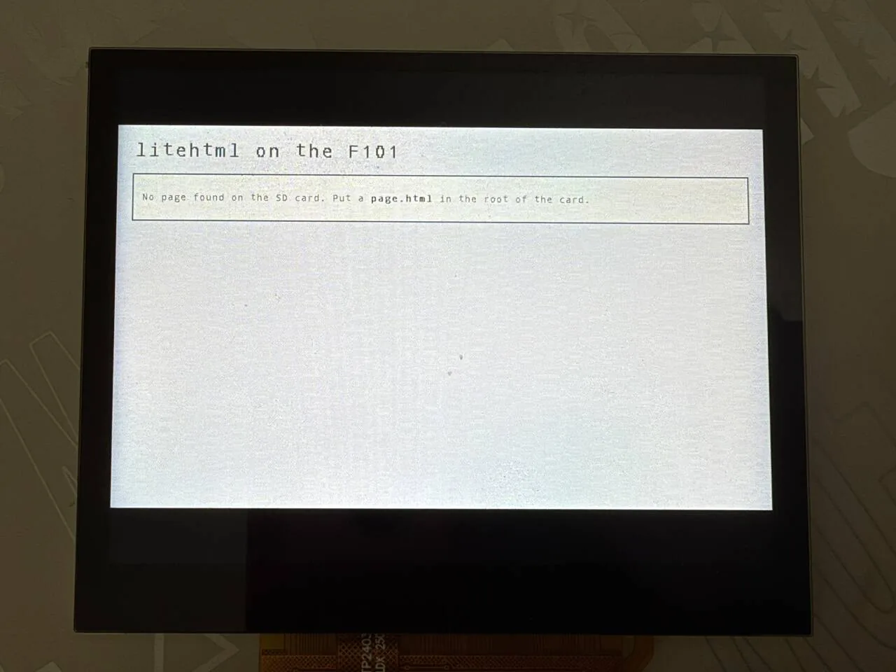

import YuzukiBoardStage from '@site/src/components/YuzukiNekoHome/YuzukiBoardStage';
import FirmwareDownloadCard from '@site/src/components/FirmwareDownloadCard';
import SourceRefBar from '@site/src/components/SourceRefBar';

# LiteHTML 网页渲染

使用轻量级 HTML/CSS 排版引擎 LiteHTML 将静态网页直接绘制到彩屏上。不插 TF 卡时自动显示内置页面；插入放有本地 HTML 的 TF 卡后，可自动解析排版并在超出一屏时平滑滚动。

<SourceRefBar sourcePath="zephyr-components/litehtml/samples/html_viewer" to="/docs/yuzukineko/dev/zephyr/apps/html" />

## 第一步：准备硬件连接

<YuzukiBoardStage defaultBoard="base" isHero={false} focusNodes={['dsi', 'slot']} />

1. 确认 YuzukiNeko 已装在 YuzukiCube-M 底板上，扣紧 `FPC1` 40 脚屏排线。
2. 通过 USB-C 串口分线器连接电脑，方便烧录与在串口终端（115200 8N1）观察排版耗时和内存统计。

## 第二步：下载并烧录固件

<FirmwareDownloadCard filename="10_litehtml-full.img" size="2.65 MiB" />

下载完成后，打开 **LYNX Imager**（全志 F101 → SPI NOR → 勾选主线 · SPI NOR），按住开发板正面 FEL 键重新上电后导入该镜像写入并等待自动重启。完整图文向导见 [烧录第一个体验固件](../start/02-flash-first-firmware.md)。

## 第三步：验证内置示例页（免 TF 卡）

先不插 TF 卡直接上电重启，屏幕居中显示内置页面 `litehtml on the F101`（1024×600 画幅居中，上下留黑边）：



此时串口终端（115200 8N1）会输出解析、排版与绘制耗时：

```text
no .html file on the SD card
page: built in
page: "litehtml", 177 px high, parsed and laid out in 17 ms
page: drawn in 11 ms
```

## 第四步：配置 TF 卡测试自定义本地网页

1. 将 TF 卡接入电脑格式化为 **FAT32**（或 exFAT）。
2. 在 TF 卡**根目录**新建 **`page.html`**（注意确认没有多余的 `.txt` 后缀），可先复制下面这段纯 HTML/CSS 测试代码保存进去（内置字体支持英文与数字，页面故意拉长以验证自动滚动）：

```html
<!doctype html>
<html>
<head>
  <style>
    body { margin: 24px; font-family: sans-serif; background: #f8fafc; color: #0f172a; }
    h1 { color: #0369a1; border-bottom: 2px solid #0369a1; padding-bottom: 8px; }
    .card { margin: 16px 0; padding: 16px; background: #ffffff; border: 1px solid #cbd5e1; }
  </style>
</head>
<body>
  <h1>YuzukiNeko LiteHTML Test</h1>
  <div class="card"><b>Offline HTML/CSS Layout</b><p>Loaded directly from /SD:/page.html.</p></div>
  <div class="card"><b>Auto Scroll Check</b><p>When height exceeds 600px, the viewer scrolls automatically.</p></div>
</body>
</html>
```

3. 核对 TF 卡根目录结构（若没放 `page.html`，固件也会自动读取根目录找到的第一个 `.html` / `.htm` 文件）：

```text
TF 卡根目录/
└── page.html    # 优先读取；若含本地图片可一并拷到同级目录
```

4. 安全弹出读卡器，将 TF 卡插入 YuzukiNeko 正面右侧卡槽，断电重插 USB-C 线重启，即可看到屏幕渲染出你自己的网页（高度超过 600 px 时会自动向下匀速滚动并循环回顶）。

## 常见问题排查

| 现象 | 可能原因 | 解决方法 |
| --- | --- | --- |
| 插卡重启后依然显示内置页面 | 网页放在子目录、文件名多了 `.txt` 后缀或卡未插稳 | 确认 TF 卡根目录直接存在 `page.html`，且卡为 FAT32/exFAT 格式 |
| 页面里写了中文显示成方框 | 默认固件仅内置 10×16 ASCII 点阵字库 | 英文页面开箱即可显示；需要中文显示时按二期源码详解准备 `/SD:/font.lhf` |
| 页面里的按钮点不动或 JS 动画不跑 | LiteHTML 只负责静态 HTML/CSS 排版渲染 | 属设计范围，不含 JavaScript 引擎和触摸输入 |

---

[上一项：PocketJS 界面应用](09-pocketjs.md) · [下一项：MicroPython 脚本](11-micropython.md) · [应用总览](overview.md)
