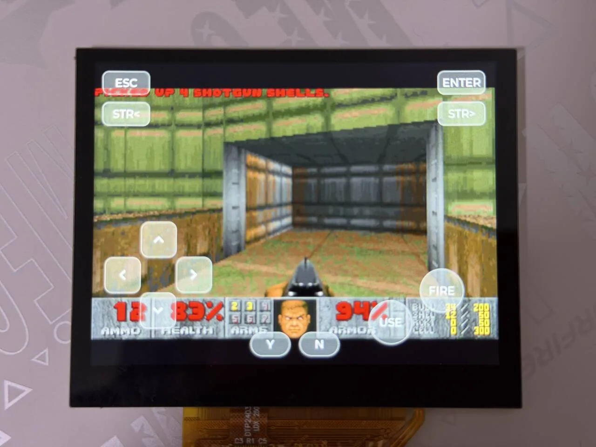

import YuzukiBoardStage from '@site/src/components/YuzukiNekoHome/YuzukiBoardStage';
import FirmwareDownloadCard from '@site/src/components/FirmwareDownloadCard';
import SourceRefBar from '@site/src/components/SourceRefBar';

# Doom 毁灭战士

从 TF 卡加载 WAD 游戏数据，画面自动硬件缩放铺满 1024×768 彩屏，叠加半透明 5 点触控虚拟按键并通过底板扬声器输出实时游戏音效。

<SourceRefBar sourcePath="zephyr-components/doom/samples/doom_player" to="/docs/yuzukineko/dev/zephyr/apps/doom" />

## 第一步：准备硬件连接

<YuzukiBoardStage defaultBoard="base" isHero={false} focusNodes={['dsi', 'amp', 'slot']} />

1. 确认 YuzukiNeko 已装在 YuzukiCube-M 底板上，并接好外设：
   - **显示与触摸**：40 脚排线扣紧在 `FPC1`；
   - **扬声器**：2 脚扬声器插在底板 `CN3`（体验经典枪声与背景音效）。
2. 通过 USB-C 线（或经串口分线器）连接电脑，方便烧录与查看串口加载日志。

## 第二步：准备 WAD 文件并配置 TF 卡（必做）

游戏数据（`.wad` 文件）不包含在固件中，需提前拷入 TF 卡：

1. 获取 WAD 数据文件（二选一）：
   - **免费开源推荐**：前往 [freedoom.github.io](https://freedoom.github.io) 下载免费社区版数据包，解压得到 **`freedoom1.wad`**；
   - **自备原版**：如果你已有正版/共享版 `doom1.wad` 或 `doom.wad`，也可直接使用。
2. 将 TF 卡格式化为 **FAT32**（或 exFAT），把 `.wad` 文件直接复制到 TF 卡**根目录**（固件优先读取 `doom1.wad`，找不到时自动选用根目录里找到的第一个 `.wad` 文件）：

```text
TF 卡根目录/
└── freedoom1.wad    # 或 doom1.wad（任选其一放根目录即可）
```

3. 安全弹出读卡器，将 TF 卡插入 YuzukiNeko 正面右侧卡槽。

## 第三步：下载并烧录固件

<FirmwareDownloadCard filename="12_doom-full.img" size="2.97 MiB" />

下载完成后，打开 **LYNX Imager**（全志 F101 → SPI NOR → 勾选主线 · SPI NOR），按住开发板正面 FEL 键重新上电后导入该镜像写入并等待自动重启。完整图文向导见 [烧录第一个体验固件](../start/02-flash-first-firmware.md)。

## 第四步：上电开玩与功能验证

1. 确认 TF 卡已插紧后上电，几秒内进入游戏主画面，屏幕上叠加半透明虚拟按键（游戏配置文件 `doom.cfg` 与存档目录 `.savegame/` 会自动写回 TF 卡）：



2. **验证多点触控与音效**：试着用左手按住方向键移动、右手同时点开火或开门键（支持最多 5 点同时触控，按下时按键高亮），确认动作流畅且底板 `CN3` 扬声器同步出声。
3. **核对串口日志（可选）**：串口终端（115200 8N1）会打印识别到的 WAD 路径与图形初始化信息：

```text
WAD /SD:/doom1.wad
I_InitGraphics: DOOM screen size: w x h: 320 x 200
```

## 常见问题排查

| 现象 | 可能原因 | 解决方法 |
| --- | --- | --- |
| 屏幕无画面，串口提示 `no .wad file on the card` | TF 卡未放 `.wad` 文件、放在子目录或卡未插牢 | 确认卡格式化为 FAT32/exFAT，并将 `.wad` 文件直接放在 TF 卡根目录 |
| 没有游戏音效 | 底板 `CN3` 未接扬声器或接触不良 | 检查 `CN3` 2 脚扬声器是否插紧 |
| 同时按方向和开火偶发断触 | 手指偏离虚拟按键区域 | 尽量按在半透明按键中心，按键变亮即代表已命中 |

---

[上一项：MicroPython 脚本](11-micropython.md) · [下一项：NES 红白机模拟](13-nes.md) · [应用总览](overview.md)
