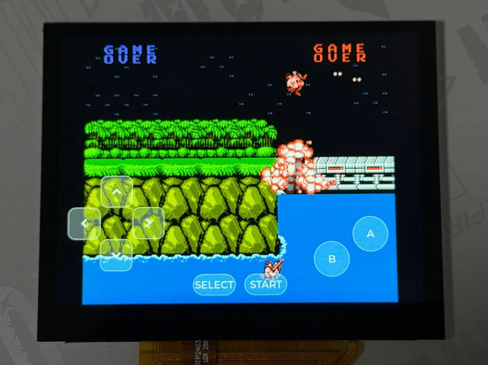

import YuzukiBoardStage from '@site/src/components/YuzukiNekoHome/YuzukiBoardStage';
import FirmwareDownloadCard from '@site/src/components/FirmwareDownloadCard';
import SourceRefBar from '@site/src/components/SourceRefBar';

# NES 红白机模拟

搭载 nofrendo 红白机 FC 模拟核心，从 TF 卡读取 `.nes` 游戏并全屏硬件缩放显示，配合 5 点触控半透明虚拟手柄与 48 kHz 音频输出，即刻重温经典 8 位游戏。

<SourceRefBar sourcePath="zephyr-components/nes/samples/nes_player" to="/docs/yuzukineko/dev/zephyr/apps/nes" />

## 第一步：准备硬件连接

<YuzukiBoardStage defaultBoard="base" isHero={false} focusNodes={['dsi', 'amp', 'slot']} />

1. 确认 YuzukiNeko 已装在 YuzukiCube-M 底板上，扣紧 `FPC1` 40 脚屏排线，并将 2 脚扬声器插到底板 `CN3`。
2. 通过 USB-C 线（或经串口分线器）连接电脑，方便烧录与查看串口日志。

## 第二步：准备 `.nes` 游戏并配置 TF 卡（必做）

游戏 ROM 需自行准备（请使用合法拥有的游戏备份或开源自制 `.nes` 游戏）：

1. 将 TF 卡格式化为 **FAT32**（或 exFAT）。
2. 挑选标准 iNES 格式的 **`.nes`** 文件（单个文件不超过 **2 MiB**），直接复制到 TF 卡**根目录**。
3. 固件启动时优先加载 `/SD:/game.nes`；若根目录没有 `game.nes`，会自动加载扫描到的**第一个 `.nes` 文件**（若放了多个 `.nes`，想指定哪一款直接改名为 `game.nes` 即可）：

```text
TF 卡根目录/
└── game.nes    # 优先读取；也可放任意命名的 .nes 文件在根目录
```

4. 安全弹出读卡器，插入 YuzukiNeko 正面右侧卡槽。带电池记忆的游戏会在同目录自动生成并每 3 秒同步一次同名 `.sav` 存档。

## 第三步：下载并烧录固件

<FirmwareDownloadCard filename="13_nes-full.img" size="2.75 MiB" />

下载完成后，打开 **LYNX Imager**（全志 F101 → SPI NOR → 勾选主线 · SPI NOR），按住开发板正面 FEL 键重新上电后导入该镜像写入并等待自动重启。完整图文向导见 [烧录第一个体验固件](../start/02-flash-first-firmware.md)。

## 第四步：上电开玩与多指触控测试

1. 确认 TF 卡插好后上电，开发板自动识别 NTSC（60 Hz）/ PAL（50 Hz）制式，放大居中显示游戏画面并叠加半透明屏幕手柄：



2. **核对按键布局并试玩**：
   - **左下角**：十字方向键；
   - **右下角**：B、A 圆形动作键；
   - **底部中间**：SELECT 与 START 键（按 START 开始游戏）。
3. **测试多点触控与声音**：按住右方向键的同时连点 A/B 键（支持最多 5 指同按，按下即时变色高亮），确认操作跟手、底板 `CN3` 扬声器背景音乐与音效清晰不破音。

## 常见问题排查

| 现象 | 可能原因 | 解决方法 |
| --- | --- | --- |
| 串口提示 `no .nes file on the card` | `.nes` 文件放在子文件夹里，或卡未格式化为 FAT32/exFAT | 将 `.nes` 直接放到 FAT32/exFAT TF 卡根目录后重新上电 |
| 某款 ROM 启动报错退出 | 使用了冷门 Mapper 或文件超过 2 MiB 上限 | 换用常见 Mapper（如 Mapper 0/1/2/3/4）且小于 2 MiB 的标准 `.nes` 文件 |
| 游戏无声音 | 底板 `CN3` 未接扬声器 | 检查 2 脚扬声器是否插紧在 `CN3` |

---

[上一项：Doom 毁灭战士](12-doom.md) · [下一项：mGBA 掌机模拟](14-mgba.md) · [应用总览](overview.md)
