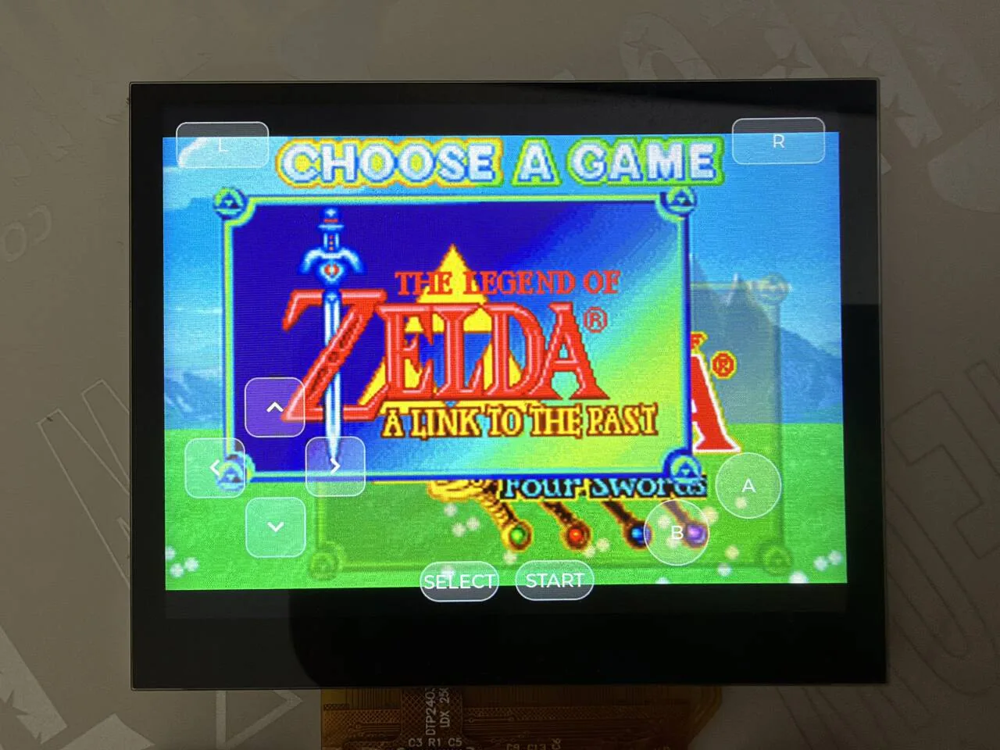

import YuzukiBoardStage from '@site/src/components/YuzukiNekoHome/YuzukiBoardStage';
import FirmwareDownloadCard from '@site/src/components/FirmwareDownloadCard';
import SourceRefBar from '@site/src/components/SourceRefBar';

# mGBA 掌机模拟

搭载高兼容性 mGBA 模拟核心，**同时支持 Game Boy（`.gb`）、Game Boy Color（`.gbc`）和 Game Boy Advance（`.gba`）游戏**，内置替代 BIOS（免自备 BIOS），支持硬件放大、48 kHz 伴音与自动存档。

<SourceRefBar sourcePath="zephyr-components/mgba/samples/gba_player" to="/docs/yuzukineko/dev/zephyr/apps/mgba" />

## 第一步：准备硬件连接

<YuzukiBoardStage defaultBoard="base" isHero={false} focusNodes={['dsi', 'amp', 'slot']} />

1. 确认 YuzukiNeko 已装在 YuzukiCube-M 底板上，扣紧 `FPC1` 40 脚屏排线，并将 2 脚扬声器插到底板 `CN3`。
2. 通过 USB-C 线（或经串口分线器）连接电脑，方便烧录与查看串口帧率统计。

## 第二步：准备掌机 ROM 并配置 TF 卡（必做）

游戏 ROM 需自备（请使用合法拥有的游戏备份或开源自制 ROM）：

1. 将 TF 卡格式化为 **FAT32**（或 exFAT）。
2. 将单文件 **不超过 10 MiB** 的 `.gba`、`.gb` 或 `.gbc` 文件直接复制到 TF 卡**根目录**（若要运行超过 10 MiB 的大容量 GBA 游戏，请改用下一项 [gpSP 动态重编译](15-gpsp.md)）。
3. 固件优先加载 `/SD:/game.gba`；找不到时按 `.gba` → `.gb` / `.gbc` 顺序自动加载根目录里的第一个合法 ROM（想指定某款游戏，改名为 `game.gba` 即可）：

```text
TF 卡根目录/
└── game.gba    # 优先读取（<= 10 MiB，免 BIOS）；也可直接放任意 .gba/.gb/.gbc
```

4. 安全弹出读卡器，插入 YuzukiNeko 正面右侧卡槽。游戏存档会自动保存为同目录的同名 `.sav` 文件（每 3 秒检查变化并写回一次）。

## 第三步：下载并烧录固件

<FirmwareDownloadCard filename="14_mgba-full.img" size="3.23 MiB" />

下载完成后，打开 **LYNX Imager**（全志 F101 → SPI NOR → 勾选主线 · SPI NOR），按住开发板正面 FEL 键重新上电后导入该镜像写入并等待自动重启。完整图文向导见 [烧录第一个体验固件](../start/02-flash-first-firmware.md)。

## 第四步：上电试玩与串口帧率核对

1. 插好 TF 卡上电，240×160 游戏画面自动硬件缩放居中显示在 1024×768 屏幕上，叠加完整的 10 键半透明虚拟手柄（顶部左右角 L/R、左下方向键、右下 A/B、底部中间 SELECT/START，支持 5 指同时触控）：



2. 试玩并验证 `CN3` 扬声器输出正常；打开串口终端（115200 8N1）每 5 秒可看到一次运行统计：

```text
ROM /SD:/game.gba, save /SD:/game.sav
gba: 300 frames, emulation 11407 us/frame, sound 241097 frames pushed, underruns 0
```

## 常见问题排查

| 现象 | 可能原因 | 解决方法 |
| --- | --- | --- |
| 串口提示找不到 ROM 或加载报错 | 文件放在子目录，或 `.gba` 文件超过了 10 MiB 限制 | 将 10 MiB 以内的 ROM 直接放根目录；16～32 MiB 的 GBA 大作请改用 `15_gpsp-full.img` |
| 复杂画面下略有掉帧或声音轻卡 | 纯解释执行在重负载 GBA 场景算力接近上限 | 游玩 GBA 游戏推荐体验带动态重编译加速的 `15_gpsp-full.img`，帧耗时减半以上 |
| 游戏内存档后重启进度没保存 | 存档后立刻断电，未等到 3 秒自动落盘周期 | 游戏内存档后等待约 3～5 秒再断电 |

---

[上一项：NES 红白机模拟](13-nes.md) · [下一项：gpSP 动态重编译](15-gpsp.md) · [应用总览](overview.md)
