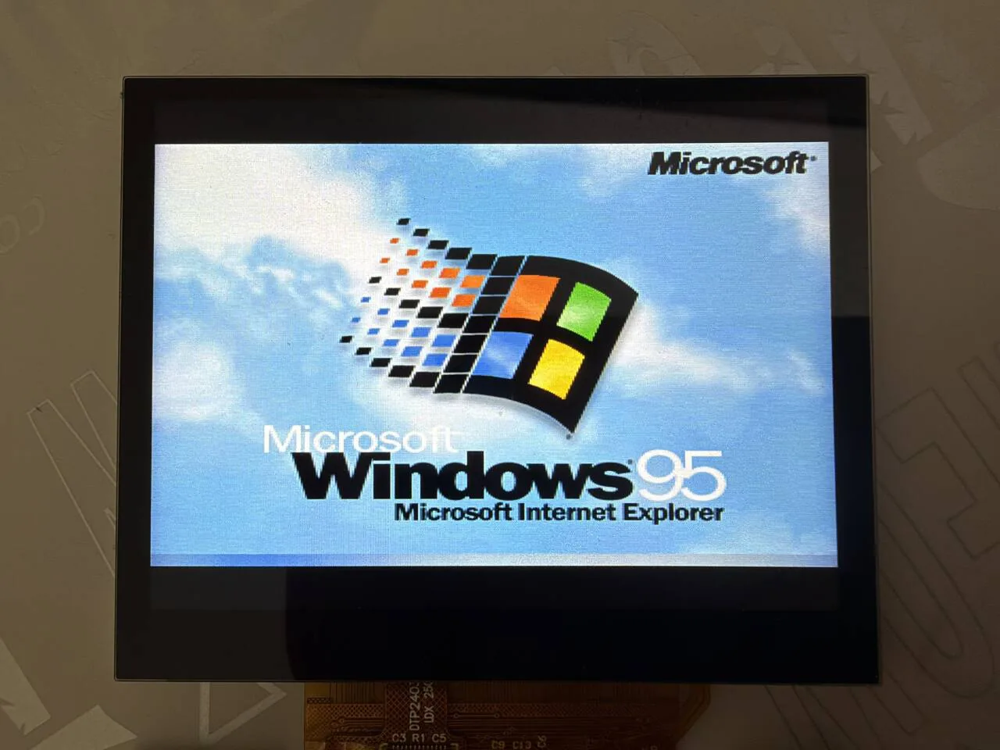
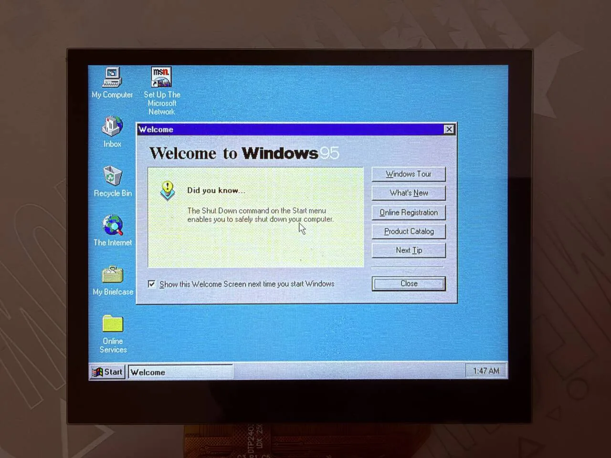

import YuzukiBoardStage from '@site/src/components/YuzukiNekoHome/YuzukiBoardStage';
import FirmwareDownloadCard from '@site/src/components/FirmwareDownloadCard';
import SourceRefBar from '@site/src/components/SourceRefBar';

# Win95 · Bochs x86

在 YuzukiNeko 的 16 MiB PSRAM 上运行 Bochs x86（i486）虚拟机，从 TF 卡平铺硬盘镜像引导启动经典的 **Windows 95 桌面**，并用电脑串口终端作为虚拟机的键盘输入。

<SourceRefBar sourcePath="zephyr-components/bochs/samples/pc" to="/docs/yuzukineko/dev/zephyr/apps/win95" />

## 第一步：准备硬件与串口终端

<YuzukiBoardStage defaultBoard="base" isHero={false} focusNodes={['dsi', 'slot', 'uart']} />

1. 确认 YuzukiNeko 已装在 YuzukiCube-M 底板上，扣紧 `FPC1` 40 脚屏排线。
2. 务必通过 USB-C 串口分线器连接电脑，打开交互式串口终端（MobaXterm / PuTTY，115200 8N1）—— 启动日志观察与 Windows 95 键盘按键都通过串口进行。

## 第二步：准备硬盘镜像并配置 TF 卡（必做）

本固件不附带 Windows 镜像，需自行准备符合几何规格的平铺硬盘镜像并确认授权：

1. 准备平铺（flat）硬盘镜像 **`windows95b.img`**（必须是已安装好系统的整盘平铺镜像，参数 `507 柱面 / 16 磁头 / 63 扇区`，**文件大小必须精确为 `261,660,672` 字节**，不支持 ISO / VHD / VMDK 格式）：可打开 Bochs 社区归档页 [archive.org/details/bochs_windows_images](https://archive.org/details/bochs_windows_images)，在右侧 `ZIP FILES` 列表点击红框中的 **`Windows 95.zip`** 下载并解压出 `windows95b.img`：

<figure style={{ maxWidth: '820px', margin: '0.75rem auto 1.25rem', border: '1px solid var(--ifm-color-emphasis-200)', borderRadius: '10px', overflow: 'hidden', background: 'var(--ifm-background-surface-color)' }}>
  
  <figcaption style={{ padding: '0.5rem 0.75rem', fontSize: '0.82rem', color: 'var(--ifm-color-emphasis-700)', lineHeight: 1.45, textAlign: 'center' }}>
    在 archive.org 右侧 ZIP FILES 列表中点击红框处的 Windows 95.zip，下载后解压得到 windows95b.img
  </figcaption>
</figure>
2. **先在电脑保留一份备份**：Windows 95 运行期间会向镜像写入注册表和交换文件，异常断电损坏后可直接用备份覆盖还原。
3. 将 TF 卡格式化为 **FAT32**（或 exFAT），把 `windows95b.img` 复制到 TF 卡**根目录**：

```text
TF 卡根目录/
└── windows95b.img    # 必放，精确 261,660,672 字节（249 MiB）平铺镜像
```

4. 安全弹出读卡器，插入 YuzukiNeko 正面右侧卡槽。

## 第三步：下载并烧录固件

<FirmwareDownloadCard filename="16_win95_bochs-full.img" size="2.88 MiB" />

下载完成后，打开 **LYNX Imager**（全志 F101 → SPI NOR → 勾选主线 · SPI NOR），按住开发板正面 FEL 键重新上电后导入该镜像写入并等待自动重启。完整图文向导见 [烧录第一个体验固件](../start/02-flash-first-firmware.md)。

## 第四步：观察 BIOS 启动并进入 Windows 95 桌面

1. **查看串口 BIOS 自检日志**：插好 TF 卡上电后，串口终端依次打印 TF 卡挂载、`ata0 master: Generic 1234 ATA-6 Hard-Disk (249 MBytes)` 以及 `Starting Windows 95...`。
2. **等待蓝天白云启动画面**：屏幕切换到经典的 Windows 95 启动画面（纯软件解释模拟 486 CPU，完整启动到桌面通常需要等待约数分钟，请耐心等待不要中途断电）：



3. **进入桌面并用串口键盘操作**：加载完成后屏幕出现经典的 Windows 95 桌面与 Welcome 弹窗；在电脑串口终端窗口直接敲击回车、Tab、方向键或字母即可控制虚拟机内的界面：



## 常见问题排查

| 现象 | 可能原因 | 解决方法 |
| --- | --- | --- |
| 串口或 BIOS 提示找不到硬盘/启动失败 | 文件名不是 `windows95b.img` 或镜像大小与参数不匹配 | 核对 TF 卡根目录文件名精确为 `windows95b.img` 且大小为 `261660672` 字节 |
| 蓝天白云画面停了很久不动 | 纯软件模拟 x86 启动耗时较长 | 属正常现象，只要串口或画面仍在推进，耐心等待数分钟即可进桌面 |
| 下次开机报磁盘或注册表错误 | 上次未正常关机导致镜像内文件系统损坏 | 用电脑上提前备份好的原始 `windows95b.img` 重新覆盖到 TF 卡即可 |

---

[上一项：gpSP 动态重编译](15-gpsp.md) · [下一项：ncnn 神经网络推理](17-ncnn.md) · [应用总览](overview.md)
