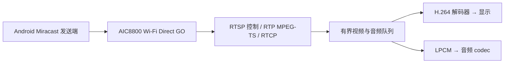

Miracast 接收器支持具有 Miracast 功能的 Android 手机的**无线显示／屏幕镜像**。它使用 AIC8800 Wi-Fi Direct、F101 H.264 解码器、显示视频层及音频 codec，不需要在手机上安装应用或开启 ADB 调试。只提供 Google Cast 的手机不能发送此协议。仅凭厂商的菜单名称不能确定是否支持。

## 配套工程源码位置与一键编译

| 项目 | 说明 |
| --- | --- |
| 源码目录 | `zephyr-components/miracast/samples/receiver` |
| 目标板级与模式 | `yuzukineko_base` · RAM（入口 `0x40000000`） |
| 一期快速体验 | 免编译直接烧录见 [Miracast 无线显示](../../../demos/02-miracast.md) |

在配套 `f101-zephyr` 工作区根目录直接执行（全部交叉工具链、依赖与子模块均已随包内置，无需 `source env.sh` 或手动 `git submodule update`）：

```sh
# 1. 一键编译（自动关联 yuzukineko_base 板级与对应 conf/overlay）
./.venv/bin/python scripts/build_apps.py --app miracast

# 2. 打包整片 SPI NOR 镜像：build/miracast/zephyr/zephyr-full.img
./.venv/bin/python scripts/pack_full_img.py --app miracast
```

生成的 `build/miracast/zephyr/zephyr-full.img` 可直接用 Windows 下的 **LYNX Imager**（主线 · SPI NOR）写入开发板，或在已透传 USB 的 WSL2 / Linux 终端执行 `./.venv/bin/python scripts/flash.py flash-full miracast`（RAM 调试阶段也可用 `./.venv/bin/python scripts/flash.py run miracast` 直接载入内存运行）。
> **当前 4.5.0 工程同步说明**：`samples/receiver/prj.conf` 已默认开启 **`CONFIG_SAMPLE_WFD_720P=y`**（1280×720p30 RGB565 输出）并调优网络与 VDEC 缓冲，已在 YuzukiNeko + YuzukiCube-M 实机验证安卓无线投屏画面与断开重连；独立样例当前音频输出尚未完成实机调试验证。

## 版本与验证

本仓库使用 Zephyr 4.5.0 分支：主机协议、P2P 控制、NekoBox 集成以及独立接收器（RAM / XIP）均已构建通过，且已在真机完成安卓手机 Wi-Fi Direct 发现、协商、1280×720p30 画面投屏与断开重连验证。

## 从 NekoBox 连接

1. 打开 [NekoBox](nekobox.md) 首页的 **Miracast**，页面自动开始接收。
2. 打开手机的**无线显示／屏幕镜像**，选择 **NekoBox Miracast**。
3. 必要时使用页面的停止、重试按钮。离开页面会停止接收器，恢复普通 Wi-Fi 和原先启用的 DLNA 服务。

Miracast 运行时独占无线接口，不能同时保留 STA 连接或 DLNA 接收器，不需要 TF 卡。等待连接时会反复打开 WPS 按键配对窗口，因此请在准备连接手机时再启动接收。

| NekoBox 配置 | 默认值 | 用途 |
| --- | --- | --- |
| `CONFIG_NEKOBOX_FEATURE_MIRACAST` | `y` | 接收器、首页磁贴和页面；设为 `n` 移除功能 |
| `CONFIG_NEKOBOX_MIRACAST_NAME` | `NekoBox Miracast` | 设备名，1–32 个可打印 ASCII 字节 |

## 构建独立接收器

在配套工程根目录直接构建（默认 RAM 运行，板级为 `yuzukineko_base`）：

```sh
./.venv/bin/python scripts/build_apps.py --app miracast
./.venv/bin/python scripts/pack_full_img.py --app miracast
```

XIP 使用独立输出目录：

```sh
./.venv/bin/west build -b yuzukineko_base -d build/miracast-xip zephyr-components/miracast/samples/receiver -- \
  -DEXTRA_CONF_FILE=xip.conf -DEXTRA_DTC_OVERLAY_FILE=boards/yuzukineko_xip.overlay
```

如需烧录 XIP 版本，可再按[Flash 布局与进阶调试](../../../boot/flash-layout.md)中的 XIP 流程将应用写入 NOR `0x80000`（当前版本的 FEL loader 在 RAM `0x20000` 运行），或直接运行 `scripts/pack_full_img.py --app miracast-xip` 打包整片镜像。

等待串口出现 `Miracast: discoverable`，再在手机上选择 **YuzukiNeko Miracast**。样例通过串口报告会话状态和解码帧数。手机断开后移除组并重新准备接收。

| 样例配置 | 默认值 | 用途 |
| --- | --- | --- |
| `CONFIG_SAMPLE_WFD_NAME` | `YuzukiNeko Miracast` | 广播设备名，1–32 个可打印 ASCII 字节 |
| `CONFIG_SAMPLE_WFD_720P` | `y`（`prj.conf` 默认启用） | 额外提供 1280×720p30，需要更多解码内存和吞吐量 |
| `CONFIG_SAMPLE_WFD_PEER` | 空 | 通过已有链路进行传输测试，跳过 P2P 建组 |

默认提供必选的 640×480p60、constrained-baseline H.264 level 3.1 以及 LPCM 48 kHz、16 位立体声。协商时序不代表板子能按该帧率交付每一帧。

## 协议与应用接口



核心覆盖 RTSP M1–M7、暂停／继续、TEARDOWN、保活和 IDR 请求。RTP payload type 33 承载 MPEG-TS，解析 PAT/PMT、PES 与 PTS。支持 RTCP 接收报告和 BYE。丢包或不连续触发恢复，媒体按配置的源地址和协商端口校验。

将 `miracast/` 加入 `ZEPHYR_EXTRA_MODULES`，启用 `CONFIG_MIRACAST` 并包含 `<miracast/miracast.h>`。`miracast_receiver_start()` 异步启动，start/stop 应在应用线程调用，不能在回调内调用。回调缓冲仅在返回前有效，应复制到有界队列后再解码。F101 播放器需启用 `CONFIG_MIRACAST_PLAYER`，包含 `<miracast/player.h>`，先启动播放器，再将 `miracast_player_media` 传给接收器。停止时先停接收器，再停播放器。NekoBox 的 UI 与播放器控制归 UI 线程。

尚未实现 HDCP／受保护内容、UIBC／触摸回传、TCP 交织媒体、RTP FEC、包重排、STA/GO 并存或 P2P group-client。样例提供 LPCM。核心可选的 AAC 处理需要应用提供解码器。

## 主机检查

```sh
sh zephyr-components/miracast/tests/host/run.sh
sh zephyr-components/aic8800/tests/p2p/run.sh
sh zephyr-components/nekobox/tests/miracast/run.sh
```

需要 GCC、Python 3 和带 libx264 的 FFmpeg。ASan/UBSan 检查覆盖分片 RTSP 与传输流、错误报文、媒体限制、丢包恢复、RTCP、保活、多次 socket 清理和应用生命周期。P2P 测试使用无线接口桩，不验证手机上的 Wi-Fi 发现。
