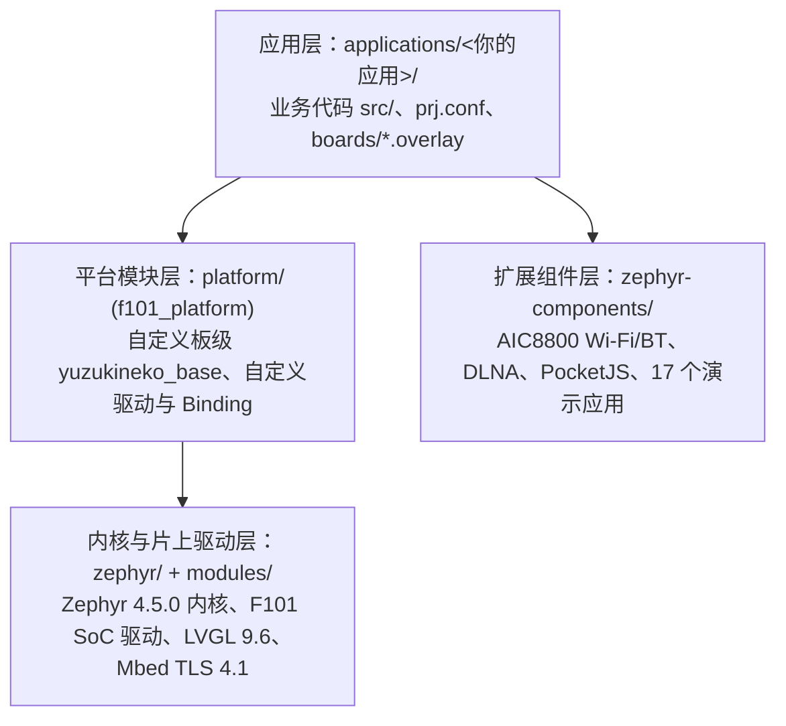

# 认识工程与新建应用

完成前序准备后，你已经能编译并运行现成的示例。本课将拆解 `f101-zephyr` 工作区的分层结构，剖析最小 Zephyr 应用 `hello_f101` 的核心文件，并亲手用脚手架创建一个独立的新应用。

## 工作区的三层职责划分

与传统单目录工程不同，Zephyr 工程将**内核框架、平台扩展、业务应用**清晰解耦。在 `f101-zephyr` 根目录中，主要目录分工如下：



- **平时写代码只动 `applications/`**：自己的项目新建在 `applications/` 下，不会污染 `zephyr/` 与 `zephyr-components/` 源码，后续同步配套 Git 仓库更新时几乎不会产生冲突。
- **改板级硬件配置看 `platform/`**：底板板级 `yuzukineko_base` 位于 `platform/boards/yuzukihd/yuzukineko_base/`，通过 `platform/zephyr/module.yml` 以标准 Zephyr Module 方式接入构建系统。
- **构建工具全部封装在 `.venv/` 与 `tools/`**：始终使用 `./.venv/bin/west` 和 `./.venv/bin/python`，不依赖宿主机环境。

## 拆解最小工程：`applications/hello_f101`

打开 `applications/hello_f101/`，一个最简 Zephyr 应用只需三个核心文件：

| 文件 | 职责 |
| --- | --- |
| `CMakeLists.txt` | 构建入口：定位 Zephyr 构建系统、声明工程名并列出参与编译的 `.c` 文件 |
| `prj.conf` | Kconfig 功能开关：启用或关闭内核组件、驱动子系统、栈大小与日志级别 |
| `src/main.c` | 应用主逻辑：包含 `<zephyr/kernel.h>` 等标准头文件并实现 `main()` |

### 1. `CMakeLists.txt`

```cmake
cmake_minimum_required(VERSION 3.28.0)

find_package(Zephyr REQUIRED HINTS $ENV{ZEPHYR_BASE})

project(hello_f101)

target_sources(app PRIVATE src/main.c)
```

- `find_package(Zephyr ...)` 会自动加载目标板级（如 `yuzukineko_base`）、设备树编译规则及工作区内所有 Zephyr 模块。
- 后续新增源文件（例如 `src/sensor.c`）时，直接追加到 `target_sources(app PRIVATE ...)` 即可。

### 2. `prj.conf`

```ini
CONFIG_PRINTK=y
CONFIG_CONSOLE=y
CONFIG_SERIAL=y
CONFIG_UART_CONSOLE=y
CONFIG_MAIN_STACK_SIZE=2048
```

- 这里只需写**应用额外需要或想要覆盖的选项**；目标板级默认配置（位于 `platform/boards/yuzukihd/yuzukineko_base/yuzukineko_base_defconfig`）会自动合并进来。
- 例如 `yuzukineko_base_defconfig` 默认已经打开了 `CONFIG_SHELL=y`（交互命令行）、`CONFIG_LOG=y`（分级日志）、`CONFIG_DISPLAY=y` 和 `CONFIG_G2D=y`。

### 3. `src/main.c`

```c
#include <zephyr/kernel.h>
#include <zephyr/sys/printk.h>

int main(void)
{
	printk("hello_f101 started on %s\n", CONFIG_BOARD_TARGET);

	while (1) {
		printk("uptime: %lld ms\n", (long long)k_uptime_get());
		k_sleep(K_SECONDS(1));
	}

	return 0;
}
```

- `k_sleep(K_SECONDS(1))` 会让出 CPU 给其他线程或空闲任务，而不是空转死等。

## 用脚本创建你的第一个独立应用

工作区提供了 `scripts/create_app.py` 脚手架，可一键从模板复制并重命名生成新工程（应用名需以英文字母开头，仅含字母、数字和下划线）：

```sh
cd ~/work/f101-zephyr
./.venv/bin/python scripts/create_app.py --name my_first_app
```

执行后会创建 `applications/my_first_app/`，并自动同步修改 `CMakeLists.txt`、`src/main.c` 与 `sample.yaml` 中的工程标识。

## 进阶改造：使用分级日志与 Zephyr Shell

在真实项目中，推荐使用 Zephyr 标准 `LOG` 子系统代替裸 `printk`，并善用板级默认开启的 **Zephyr Shell** 命令行调试状态。

将 `applications/my_first_app/src/main.c` 替换为：

```c
#include <zephyr/kernel.h>
#include <zephyr/logging/log.h>

LOG_MODULE_REGISTER(my_first_app, LOG_LEVEL_INF);

int main(void)
{
	int count = 0;

	LOG_INF("my_first_app started on %s", CONFIG_BOARD_TARGET);

	while (1) {
		LOG_INF("heartbeat #%d (uptime=%lld ms)", ++count, (long long)k_uptime_get());
		k_sleep(K_SECONDS(2));
	}

	return 0;
}
```

编译并打包整片镜像：

```sh
./.venv/bin/west build -b yuzukineko_base -d build/my_first_app applications/my_first_app
./.venv/bin/python scripts/pack_full_img.py --app my_first_app
```

烧录并复位后，打开 `UART1` 串口终端（`115200 8N1`），不仅可以看到带时间戳与模块名的分级日志，还可以在串口提示符 `uart:~$` 下直接敲入内置 Shell 命令检查系统状态：

| 常用 Shell 命令 | 作用 |
| --- | --- |
| `kernel threads` | 查看当前所有线程的优先级与栈使用水印（定位栈溢出非常有效） |
| `kernel uptime` | 查看系统上电运行时间 |
| `device list` | 列出所有已就绪的板级外设设备（`gpio`、`i2c`、`display`、`ve` 等） |
| `help` | 查看当前固件启用的全部 Shell 子命令 |

## 常用构建排查提示

| 现象 | 解决方法 |
| --- | --- |
| 修改了 `prj.conf` 或新增 `.overlay` 后不生效 | 在 `west build` 命令中添加 `-p always` 重新生成 CMake 与 Kconfig 缓存 |
| 忘记某个 Kconfig 项是否被成功选中 | 查看构建产物 `build/<应用名>/zephyr/.config`，它记录了最终生效的完整配置 |
| 串口提示栈溢出（Stack overflow） | 在 `prj.conf` 调大 `CONFIG_MAIN_STACK_SIZE` 或对应工作线程的 `K_THREAD_STACK_DEFINE` 大小 |

---

[上一篇：应用总览与预编译固件](../../../demos/overview.md) · [查阅 GPIO 驱动手册](../drivers/gpio.md) · [综合应用源码详解](../apps/android-mirror.md)
